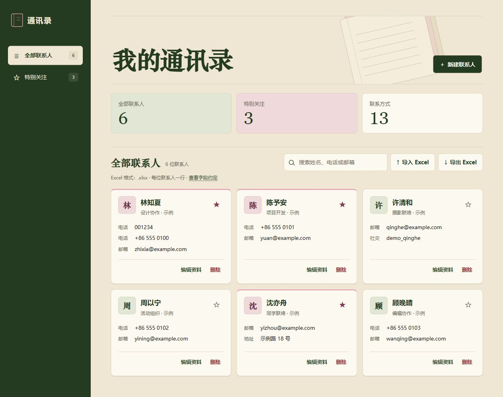

# 通讯录 | Address Book

一个支持收藏、多种联系方式和 Excel 批量导入导出的网页通讯录。前端使用原生 HTML、CSS 和 JavaScript，后端使用 FastAPI，联系人存储在 SQLite。

[在线体验](http://47.114.63.69/address-book/)



运行演示（2 分 30 秒）

https://github.com/user-attachments/assets/916eb75a-4956-4b7d-a4cb-8b9b8fc34519

## 功能

- 新建、编辑、删除和搜索联系人，按收藏状态筛选。
- 为同一联系人保存多项电话、邮箱、社交账号和地址。
- 导入 `.xlsx` 文件，校验整批数据并跳过重复联系人。导出包含全部联系人，并保留电话号码中的前导零和加号。
- 支持桌面和手机布局。联系人及收藏状态在页面刷新或服务重启后仍可读取。

当前应用是共享通讯录，访问者操作同一份数据。在线体验可用虚构联系人。

## 本地运行

需要 Python 3.11 或更新版本。先从 GitHub 克隆仓库并进入项目目录。

```sh
git clone https://github.com/linblackchen-code/address-book.git
cd address-book
```

### Windows 快速启动

双击 `start-local.cmd`，脚本会创建虚拟环境、安装依赖并启动前后端。启动后打开[本地通讯录](http://127.0.0.1:8080/frontend/)，Swagger 文档地址是 `http://127.0.0.1:8000/docs`。

双击 `stop-local.cmd` 停止服务。默认数据库位于 `backend/data/contacts.sqlite3`，启动日志位于 `.runtime/`。

### macOS 或 Linux 手动启动

在仓库根目录启动 API。

```sh
python3 -m venv .venv
.venv/bin/python -m pip install -r backend/requirements.txt
.venv/bin/python -m uvicorn backend.main:app --host 127.0.0.1 --port 8000
```

在另一个终端从仓库根目录运行以下命令，浏览器访问 `http://127.0.0.1:8080/frontend/`。

```sh
python3 -m http.server 8080 --bind 127.0.0.1
```

## 项目结构

| 目录 | 内容 |
| --- | --- |
| `frontend/` | 页面、样式和浏览器交互 |
| `backend/` | API、输入校验、SQLite、Excel 处理与回归测试 |
| `deployment/ubuntu/` | Ubuntu 部署步骤、Nginx 路由和 systemd 服务 |
| `docs/` | 接口约定、设计说明、验证记录与演示材料 |
| `tools/` | 浏览器检查与演示录制脚本 |

[更多截图与 Excel 样例](docs/submission/README.md) · [代码规范](docs/CODING_STANDARDS.md)

项目由 BLGNB 团队完成，课程为 Software Engineering (FZU–MU)。林俊晨（832401117）负责前端，陈子元（832401108）负责后端，贡献比例各 50%；双方共同完成接口约定、联调和共同博客内容。

## 博客与交付文档

- [林俊晨：前端英文定稿](docs/BLOG_FRONTEND_LIN_JUNCHEN.md) · [陈子元：后端开发记录](docs/BLOG_BACKEND_CHEN_ZIYUAN.md)
- [最终提交指南](docs/SUBMISSION_GUIDE.md) · [交付检查清单](docs/DELIVERY_CHECKLIST.md) · [版本说明](docs/RELEASE_NOTES.md)
- [接口约定](docs/API_CONTRACT.md) · [实现说明](docs/IMPLEMENTATION.md) · [Git 贡献统计](docs/GIT_CONTRIBUTIONS.md)
- [验证材料索引](docs/EVIDENCE.md)

正式截图、运行视频和样例统一放在 docs/submission/。浏览器检查工具产生的临时文件保存在被 Git 忽略的 .runtime/，不覆盖正式材料。已合并分支的开发提交和 PR 记录继续保留。
