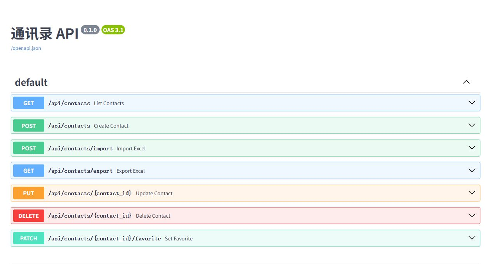

# 通讯录后端

FastAPI 提供联系人管理、收藏和 Excel 接口。Pydantic 校验请求，SQLite 持久化联系人和有序联系方式，openpyxl 读写 `.xlsx` 工作簿。

## 本地启动

安装 Python 3.11 或更新版本，在仓库根目录执行以下命令。

### Windows PowerShell

```powershell
python -m venv .venv
.\.venv\Scripts\python.exe -m pip install -r backend/requirements.txt
.\.venv\Scripts\python.exe -m uvicorn backend.main:app --host 127.0.0.1 --port 8000
```

### macOS 或 Linux

```sh
python3 -m venv .venv
.venv/bin/python -m pip install -r backend/requirements.txt
.venv/bin/python -m uvicorn backend.main:app --host 127.0.0.1 --port 8000
```

首次启动会创建数据库和表。Swagger 文档地址为 `http://127.0.0.1:8000/docs`。需要浏览器界面时，在另一个终端从仓库根目录运行 `python -m http.server 8080 --bind 127.0.0.1`，再访问 `http://127.0.0.1:8080/frontend/`。macOS 或 Linux 可使用 `python3`。

## 配置

| 环境变量 | 默认值 | 作用 |
| --- | --- | --- |
| `ADDRESS_BOOK_DB_PATH` | `backend/data/contacts.sqlite3` | 数据库文件路径。相对路径从启动目录解析 |
| `ADDRESS_BOOK_CORS_ORIGINS` | `http://127.0.0.1:8080,http://localhost:8080,http://[::1]:8080` | 允许访问 API 的前端来源，以逗号分隔 |

## 接口与数据



| 模块 | 作用 |
| --- | --- |
| `main.py` | 路由、CORS 和 HTTP 错误响应 |
| `schemas.py` | 请求和响应模型与字段校验 |
| `database.py` | 联系人与联系方式的一对多存储、事务和导入查重 |
| `excel.py` | 工作簿校验、联系人解析和导出 |

导入支持最大 5 MiB 的 `.xlsx` 文件。后端校验整份工作簿后再写入，跳过重复联系人并保留已有收藏状态。导出包含整份通讯录，每位联系人占一行，同一类型的多项联系方式用 JSON 字符串数组表示。请求字段和完整工作簿格式见[接口约定](../docs/API_CONTRACT.md)。

## 回归测试

在仓库根目录执行以下命令。测试使用临时 SQLite 数据库，覆盖联系人操作、收藏、重启后的持久化、Excel 往返与并发重复导入。

```powershell
.\.venv\Scripts\python.exe -m pip install -r backend/requirements-dev.txt
.\.venv\Scripts\python.exe -m unittest discover -s backend/tests -v
```

macOS 或 Linux 在上述命令中使用 `.venv/bin/python`。
