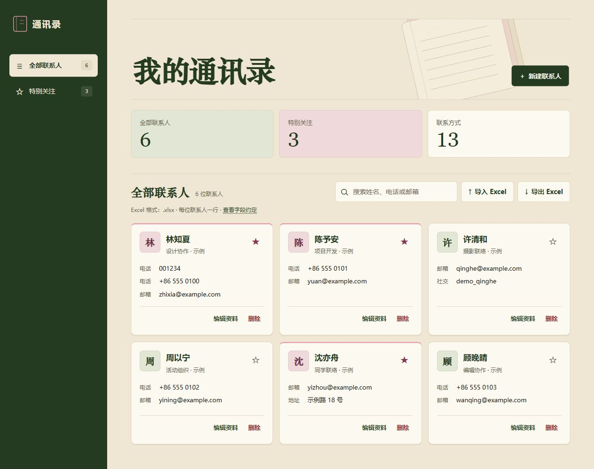
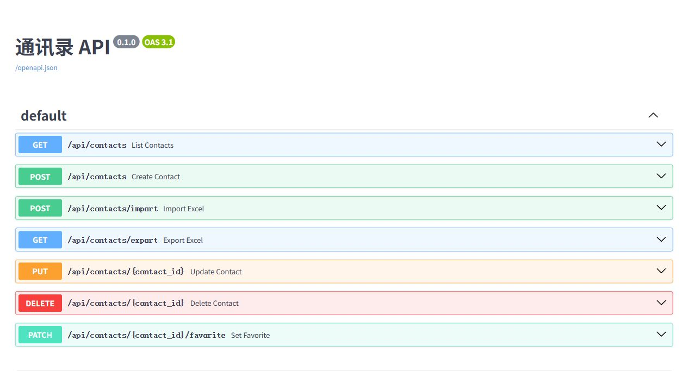
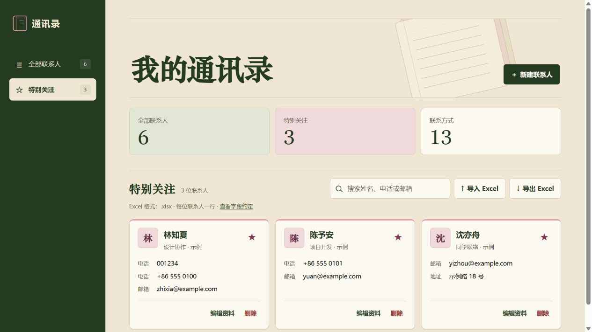
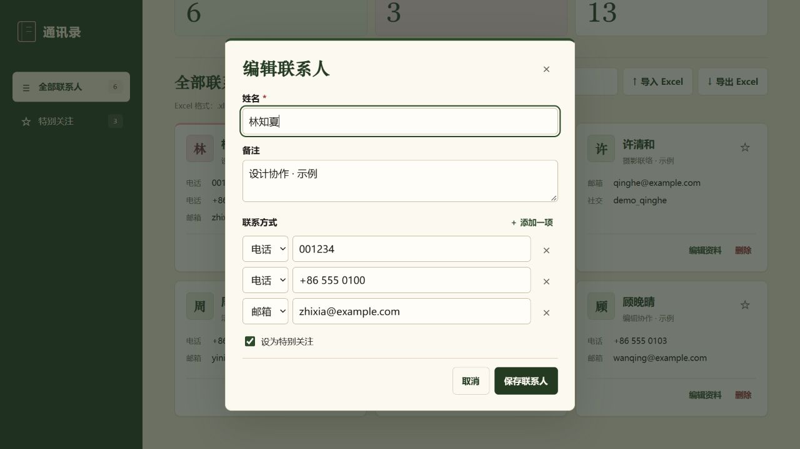
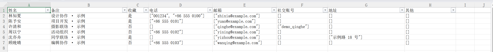
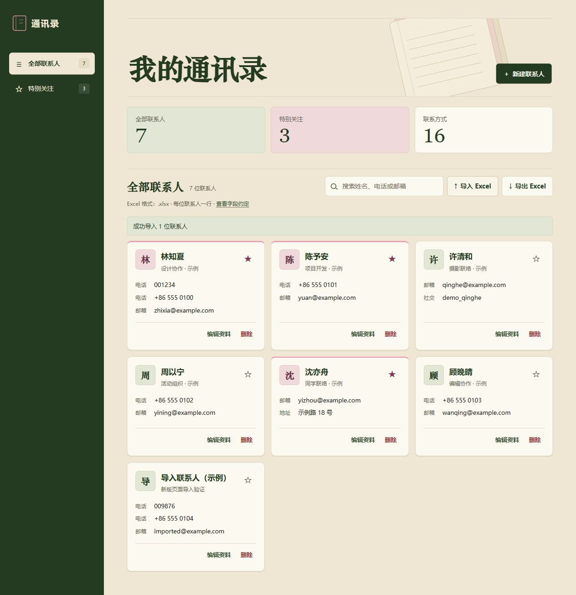
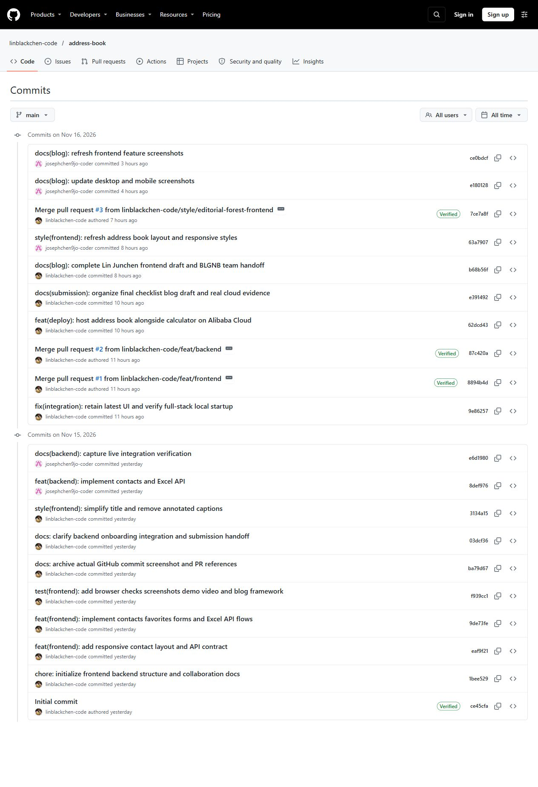
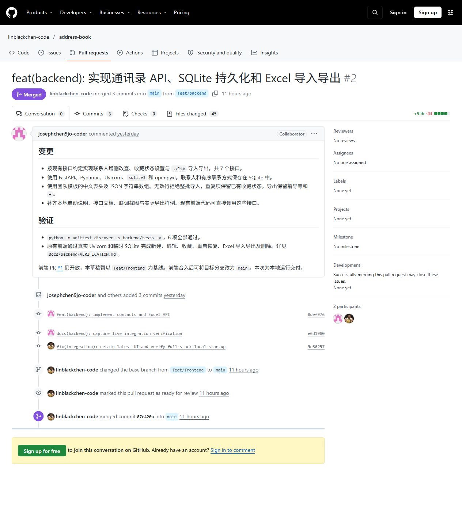

# BLGNB 极限编程作业 · 通讯录后端开发记录

| 项目 | 内容 |
| --- | --- |
| 所属课程 | Software Engineering (FZU–MU) |
| 团队名称 | BLGNB |
| 作业要求 | [Extreme Programming](https://bbs.csdn.net/topics/620593436) |
| 作业目标 | 完成联系人收藏、多联系方式和 Excel 导入导出，通过 Git 协作交付一个可运行的通讯录 |
| 作者 | 陈子元，负责后端开发和网页界面优化 |
| 合作成员 | 林俊晨，负责前端开发和阿里云部署 |
| 其他参考资料 | [团队接口约定](https://github.com/linblackchen-code/address-book/blob/main/docs/API_CONTRACT.md) · [项目实现说明](https://github.com/linblackchen-code/address-book/blob/main/docs/IMPLEMENTATION.md) |

## 目录

1. [项目概览](#1-项目概览)
2. [分工与贡献比例](#2-分工与贡献比例)
3. [技术方案与个人工作](#3-技术方案与个人工作)
4. [功能实现](#4-功能实现)
5. [Git 协作与提交记录](#5-git-协作与提交记录)
6. [联调、部署和验证](#6-联调部署和验证)
7. [合作问题与解决方法](#7-合作问题与解决方法)
8. [个人 PSP](#8-个人-psp)
9. [个人总结](#9-个人总结)

## 1. 项目概览

我们的项目是一套前后端分离的通讯录。用户可以新增、编辑、搜索和删除联系人，也可以用星标收藏联系人，在「特别关注」中集中查看。每位联系人可以有多个号码、邮箱或其他联系方式，整个通讯录支持通过 Excel 导入和导出。

- [GitHub 仓库](https://github.com/linblackchen-code/address-book)
- [阿里云在线通讯录](http://47.114.63.69/address-book/)
- [Swagger API 文档](http://47.114.63.69/address-book/docs)
- [代码规范](https://github.com/linblackchen-code/address-book/blob/main/docs/CODING_STANDARDS.md)
- [前端 PR #1](https://github.com/linblackchen-code/address-book/pull/1) · [后端 PR #2](https://github.com/linblackchen-code/address-book/pull/2) · [界面改版 PR #3](https://github.com/linblackchen-code/address-book/pull/3)
- [版本发布页](https://github.com/linblackchen-code/address-book/releases)

图 1　新版桌面页面。截图来自本地真实后端，使用独立数据库中的虚构联系人。

## 2. 分工与贡献比例

| 成员 | 主要工作 | 贡献比例 |
| --- | --- | ---: |
| 林俊晨 | 前端功能和初版页面开发，负责联系人交互、收藏筛选、动态表单和 Excel 上传下载，并完成阿里云部署与公网连通验证 | 50% |
| 陈子元 | 后端 API、数据校验、SQLite 持久化、收藏逻辑、Excel 解析生成和本地联调，并优化网页布局、样式和手机显示 | 50% |
| 合计 | 接口约定、前后端联调和功能验收由双方共同完成，计入各自比例 | 100% |

我负责实现后端接口，并在本地联调、验证数据保存和 Excel 导入导出。后续我优化了网页界面。林俊晨完成了前端功能和初版页面，并负责项目的阿里云部署及公网连通验证。 [后端功能提交 8def976](https://github.com/linblackchen-code/address-book/commit/8def976) · [后端验收提交 e6d1980](https://github.com/linblackchen-code/address-book/commit/e6d1980) · [界面优化 PR #3](https://github.com/linblackchen-code/address-book/pull/3)

## 3. 技术方案与个人工作

浏览器通过 HTTP 调用 FastAPI。Pydantic 校验姓名、收藏状态和联系方式等字段，SQLite 保存业务数据，openpyxl 读写 `.xlsx`。接口、数据校验、数据库访问和 Excel 处理分别位于 `backend/main.py`、`schemas.py`、`database.py` 和 `excel.py`。 [后端源码](https://github.com/linblackchen-code/address-book/tree/main/backend)

| 方法和路径（相对于 `/api`） | 用途 |
| --- | --- |
| `GET /contacts` | 获取联系人列表，前端据此完成搜索和收藏筛选 |
| `POST /contacts` | 新增联系人 |
| `PUT /contacts/{id}` | 更新联系人及其联系方式 |
| `DELETE /contacts/{id}` | 删除联系人 |
| `PATCH /contacts/{id}/favorite` | 设置收藏或取消收藏 |
| `POST /contacts/import` | 上传并校验工作簿，返回导入和跳过数量 |
| `GET /contacts/export` | 下载包含全部联系人的工作簿 |

补图　本地 Swagger 接口列表，涵盖联系人管理、收藏和 Excel 导入导出。

## 4. 功能实现

### 4.1 联系人、收藏与多个联系方式

数据库用两张表保存数据。联系人表 `contacts` 包含姓名、备注和收藏状态。联系方式表 `contact_methods` 用 `contact_id` 关联联系人，用 `position` 记录顺序，因此同一人可以保存两个电话和一个邮箱。编辑时，联系人字段和联系方式在同一事务中更新。删除联系人时，其联系方式也会被级联删除。

收藏接口接收明确的布尔值。例如提交 `is_favorite: true` 就保存为已收藏，同一请求重试仍会保持已收藏。浏览器在成功写入后重新读取列表，以数据库返回的状态更新星标和「特别关注」列表。

图 2　新版「特别关注」列表显示三位已收藏联系人。截图来自本地联调。

图 3　新版编辑表单显示同一联系人的两个电话和一个邮箱。截图来自本地联调。

### 4.2 Excel 导入导出

导出时每位联系人占一行，姓名、备注、收藏、电话、邮箱、社交账号、地址和其他信息各占一列。电话列可用 `["001234","+86 555 0100"]` 表示两个号码。导出将内容按文本写入，以保留前导零、加号和中文。导出范围是整个通讯录，页面搜索和收藏筛选只影响屏幕上显示的列表。 [Excel 格式与样表](https://github.com/linblackchen-code/address-book/blob/main/docs/API_CONTRACT.md)

导入时程序先检查文件和每行数据，整批校验通过后才写入 SQLite。某行格式错误时，后端返回错误提示，整批不会写入。姓名、备注和每类联系方式的值及顺序相同的记录视为重复，导入会跳过该记录并保留它已有的收藏状态。

图 4　用 Microsoft Excel 打开新版通讯录实际导出的工作簿。截图展示 6 位示例联系人和 8 列数据，林知夏的两个号码保留了前导零和加号。 [仓库中的 Excel 样例](https://github.com/linblackchen-code/address-book/blob/main/docs/submission/contacts-sample.xlsx)

图 5　新版页面提示成功导入 1 位联系人，列表新增对应卡片。截图来自本地联调。

图 6　新版页面提示无法读取损坏的工作簿，已有联系人仍在列表中。截图来自本地联调。

### 4.3 网页界面优化

我在林俊晨完成的初版页面上调整了首页、联系人卡片和编辑弹窗的布局与配色，并检查了桌面和手机宽度下的显示。图 1 展示新版首页。 [界面优化 PR #3](https://github.com/linblackchen-code/address-book/pull/3)

## 5. Git 协作与提交记录

前端在 `feat/frontend` 开发，后端在 `feat/backend` 开发。双方通过 PR 将代码合入 `main`。下表按 GitHub 提交历史显示的账号统计，截止提交为 **`ce0bdcf`（2026-11-16）**，包含后续的界面优化和文档整理。 [GitHub 提交历史](https://github.com/linblackchen-code/address-book/commits/main/)

| 成员 | GitHub 账号 | 含合并提交 | 非合并提交 |
| --- | --- | ---: | ---: |
| 林俊晨 | linblackchen-code | 15 | 12 |
| 陈子元 | josephchen9jo-coder | 5 | 5 |
| 合计 | | 20 | 17 |

图 7　GitHub `main` 提交历史，对应上表使用的 `ce0bdcf` 快照。

图 8　后端 PR #2 已合并到 `main`，包含陈子元的两次后端提交和林俊晨的一次整合提交。

## 6. 联调、部署和验证

后端有 6 项自动回归测试通过，覆盖联系人增删改查、收藏重试、重启后的持久化、字段校验、工作簿往返、批量导入失败和并发重复导入。浏览器联调还验证了实际下载的 Excel 保留多项联系方式，重启服务并刷新后仍能读到联系人和收藏状态。 [后端验证记录](https://github.com/linblackchen-code/address-book/blob/main/docs/backend/VERIFICATION.md) · [本地联调记录](https://github.com/linblackchen-code/address-book/blob/main/docs/integration/VERIFICATION.md)

我在本地完成后端联调和验证。林俊晨负责将项目部署到阿里云的 `/address-book/` 路径下，配置 Nginx 提供前端文件并转发 API 请求，并验证了公网访问。 [部署与公网验收](https://github.com/linblackchen-code/address-book/blob/main/docs/cloud/VERIFICATION.md)

我在阿里云上的新版页面录制了运行演示。录像展示了新建含多项联系方式的联系人、导入 Excel 样例、编辑资料、导出并打开工作簿，以及搜索、删除和「特别关注」筛选。 [新版通讯录运行演示（MP4，2 分 30 秒）](submission/address-book-demo.mp4)

## 7. 合作问题与解决方法

| 问题 | 处理方式与验证 |
| --- | --- |
| 同一类型可能有多个联系方式，文本中也可能出现逗号 | 双方以 `methods` 数组交换记录，并约定 Excel 中同类多值用 JSON 字符串数组表示。联调时用两个电话、一个邮箱以及带前导零和加号的数据检查导出。 |
| 正常导入、重复导入和无效文件需要不同反馈 | 后端统一返回导入数、跳过数和提示，前端按返回结果显示。重复上传同一模板时没有新增记录，损坏工作簿被拒绝。 |
| 整合时后端分支带入了较早的前端界面 | 团队在合并时对比两边的改动，保留当时最新的前端页面，并用真实后端复查表单、收藏和 Excel 流程。 |

我负责处理 Excel 重复导入。后端在同一个 SQLite 写事务里检查重复并写入新记录，再把新增数和跳过数返回给前端。联调时连续上传同一份模板，第二次新增为零。回归测试还确认了重复导入会保留用户后来修改的收藏状态。

## 8. 个人 PSP

以下时间根据本次完成的工作分项估算，单位为分钟。计划时间是事后回顾的参考预算，投入时间是回顾估算。统计范围包括后端开发、本地联调、网页界面优化和我的提交材料整理。

| PSP 阶段 | 计划时间（回顾预算，分钟） | 投入时间（回顾估算，分钟） |
| --- | ---: | ---: |
| 需求阅读与任务计划 | 25 | 25 |
| 技术准备与本地后端环境配置 | 20 | 20 |
| 设计联系人接口、请求字段和响应格式，定义 Pydantic 校验规则 | 20 | 25 |
| 实现 SQLite 联系人与联系方式的关联存储，处理编辑事务和级联删除 | 30 | 35 |
| 实现 FastAPI 联系人增删改查和收藏接口，处理请求校验和错误响应 | 35 | 40 |
| 实现 Excel 导入，校验工作簿和各行数据，跳过重复记录 | 40 | 50 |
| 实现 Excel 导出，保留多个号码、前导零和加号 | 25 | 30 |
| 编写后端回归测试并在本地联调，验证服务重启后的数据和导入失败时的处理 | 55 | 65 |
| 优化网页首页、联系人卡片和编辑弹窗的布局、配色与样式 | 30 | 35 |
| 调整手机宽度下的布局，检查搜索、收藏和表单操作 | 15 | 20 |
| 验收记录、截图与博客整理 | 40 | 55 |
| 合计 | **335（5 小时 35 分钟）** | **400（6 小时 40 分钟）** |

按这份回顾估算，后端技术准备、设计、实现与本地验证投入了 265 分钟，网页界面优化和移动端检查投入了 55 分钟，总投入比预算多 65 分钟。Excel 导入和本地验证各多用了 10 分钟，主要用于核对重复导入、无效文件的错误反馈及服务重启后的数据保留。界面优化完成后，我逐项检查桌面和手机宽度下的布局以及搜索、收藏和表单操作。下次我会按模块记录编码、测试和材料整理的时间。

## 9. 个人总结

这次作业让我把后端的几个环节连起来考虑。用 SQLite 的两张表保存联系人和联系方式，可以直接支持一个联系人有多个同类联系方式。事务把需要同时成功的写入放在一起，Excel 则把多值怎样保存、重复数据怎样处理等规则放到了用户可以检验的文件格式中。联调时，观察刷新和服务重启后的结果，也能检验页面显示和实际存储是否一致。

我印象最深的是验证 Excel 导出能不能保留电话格式。我打开实际下载的工作簿，核对同一个单元格里的 `001234` 和 `+86 555 0100` 是否保留了原值和顺序。回归测试又把导出的工作簿导入空数据库，逐项比对联系人字段。下次我会在约定接口时就准备一份包含前导零、加号和多个同类联系方式的样表，让两端从第一次联调就用同一组数据验证。
