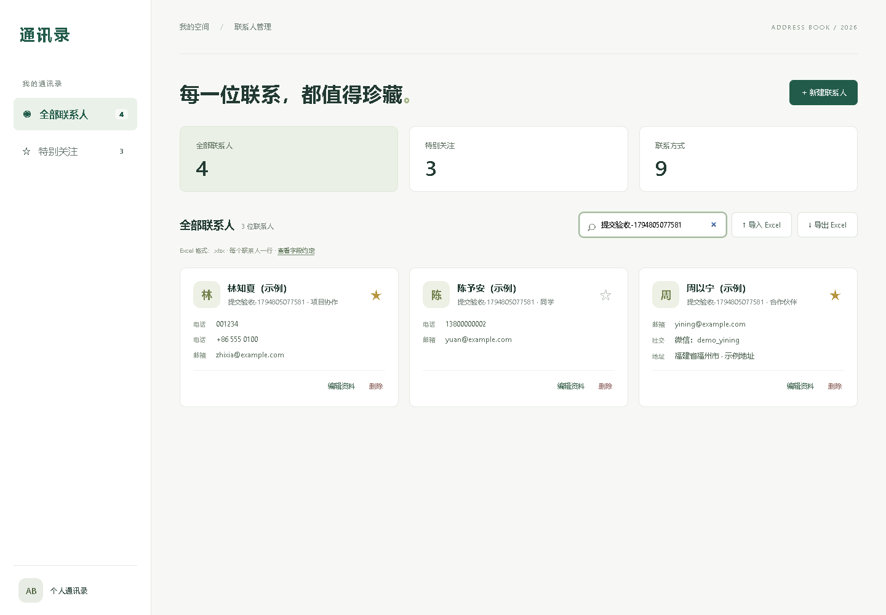
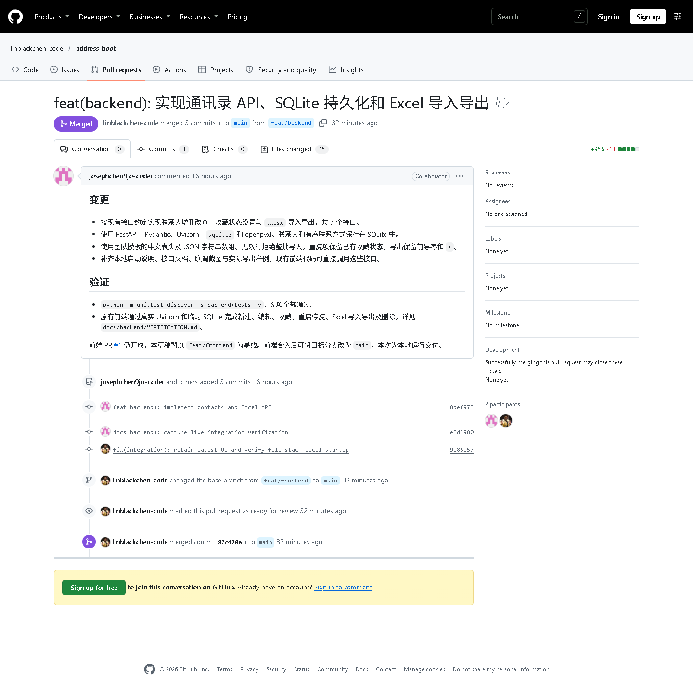
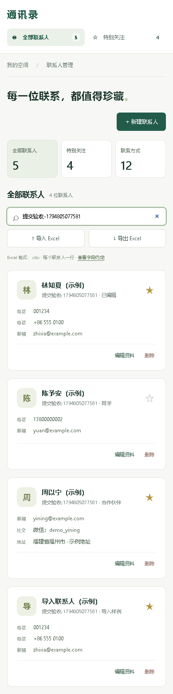
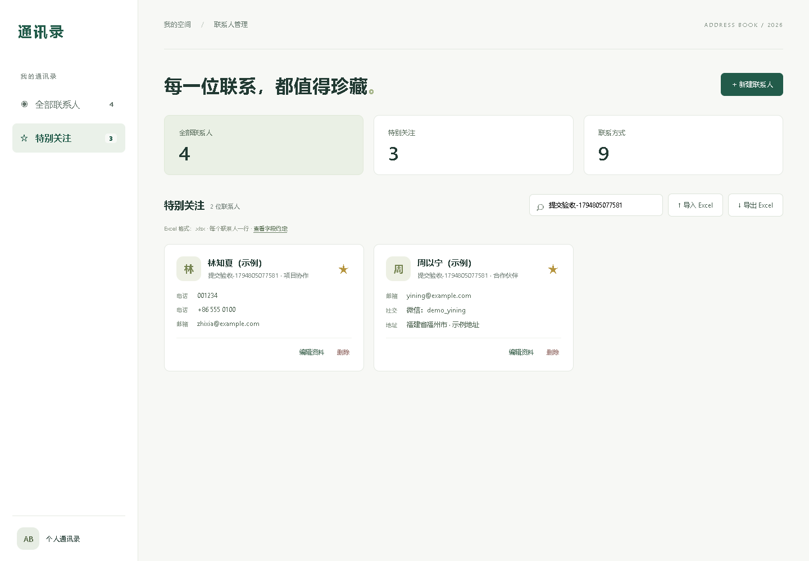
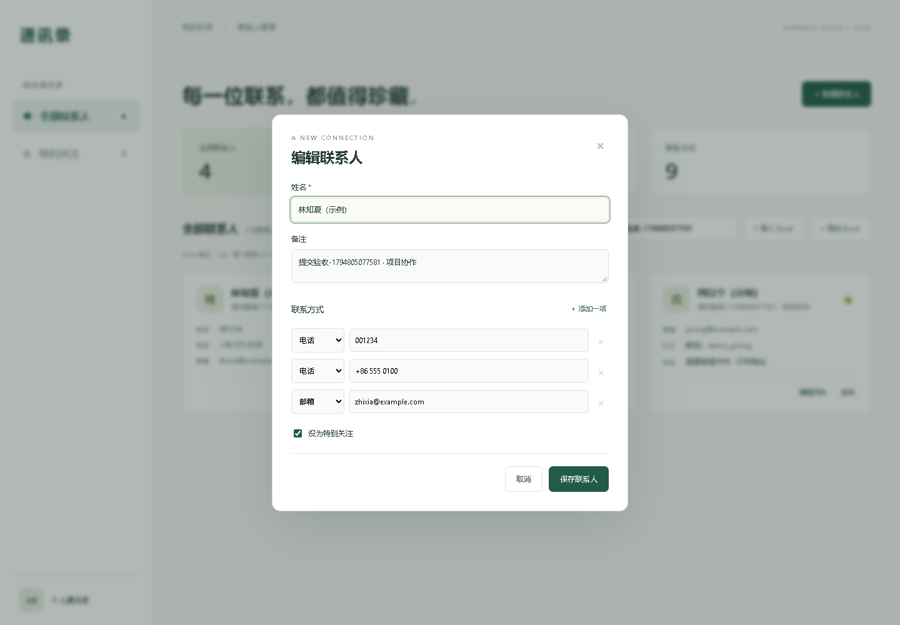
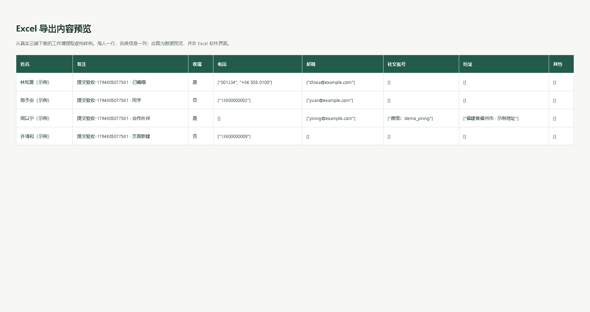
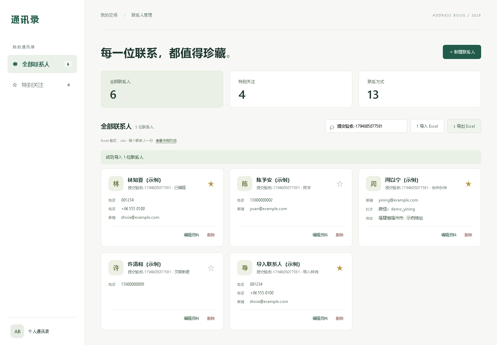
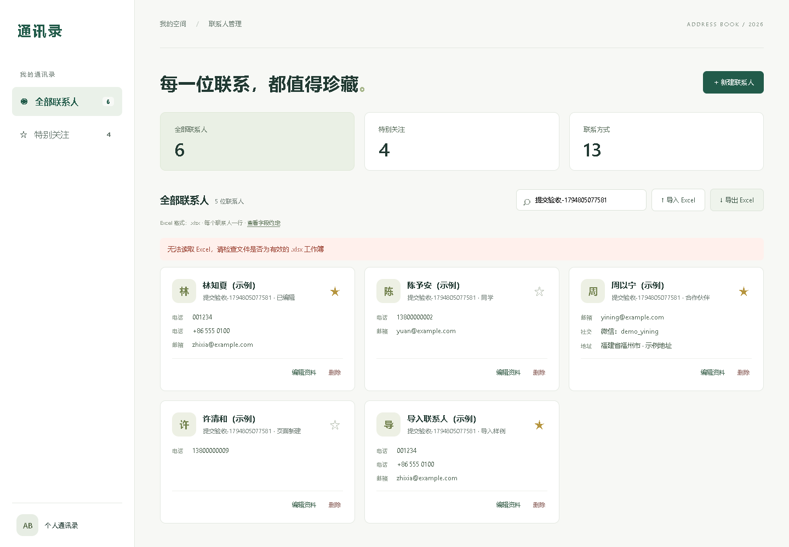

# BLGNB 团队极限编程作业：通讯录（通用框架）

> 项目共同内容和实际证据已经整理。姓名、团队名称、个人 PSP、实际分工比例及个人总结由两人分别补充。两个人必须各自发布博客。发布时上传图片/视频，替换相对地址和所有个人占位符。

| 项目 | 内容 |
| --- | --- |
| 所属课程 | Software Engineering (FZU–MU) |
| 团队名称 | BLGNB |
| 作业要求 | [Extreme Programming](https://bbs.csdn.net/topics/620593436) |
| 作业目标 | 完成收藏、多联系方式、Excel 导入导出，实践前后端分工和 Git 协作 |
| 其他参考资料 | 【按实际参考填写，文末有资料入口】 |

林俊晨已完善的个人稿见 [前端博客](BLOG_FRONTEND_LIN_JUNCHEN.md)；陈子元需要补充的个人内容见 [材料清单](TEAMMATE_MATERIALS.md)。此框架中的 PSP 必须按发布者本人填写。

## 目录

1. [项目与完成情况](#1-项目与完成情况)
2. [技术栈及模块](#2-技术栈及模块)
3. [Git 协作及提交记录](#3-git-协作及提交记录)
4. [功能实现](#4-功能实现)
5. [验证与视频](#5-验证与视频)
6. [分工与贡献比例](#6-分工与贡献比例)
7. [合作问题和解决方法](#7-合作问题和解决方法)
8. [个人 PSP](#8-个人-psp)
9. [个人总结及参考资料](#9-个人总结及参考资料)

## 1. 项目与完成情况

**【前端核对】** 页面截图与交互。**【后端核对】** 接口、持久化和 Excel。**【共同核对】** 公网、PR、Release。

- 仓库：https://github.com/linblackchen-code/address-book
- 公网：http://47.114.63.69/address-book/
- [代码规范](https://github.com/linblackchen-code/address-book/blob/main/docs/CODING_STANDARDS.md)
- [API 文档](http://47.114.63.69/address-book/docs)
- PR [#1](https://github.com/linblackchen-code/address-book/pull/1)、[#2](https://github.com/linblackchen-code/address-book/pull/2) 已合并。
- Release：【发布 v1.0.0 后填写链接，说明草稿见 RELEASE_NOTES.md】。

页面、收藏、多联系方式、真实 Excel 导入导出均已完成，已部署至阿里云。数据由 SQLite 持久化，支持手机布局。

图片通过 SSH 隧道访问同一真实云服务采集，未使用模拟响应；访问与数据范围见 [材料说明](submission/README.md)。

## 2. 技术栈及模块

**【前端补个人设计解释】** 原生 HTML/CSS/JavaScript，fetch、动态表单和响应式布局。
**【后端补个人设计解释】** FastAPI、Pydantic、Uvicorn、SQLite、openpyxl。
**【共同参考】** [实现思路和数据模型](IMPLEMENTATION.md)、[最终接口约定](API_CONTRACT.md)。

浏览器负责界面与交互，后端负责校验、数据存储和 Excel 处理。contacts 与 contact_methods 一对多关联，用 position 保留联系方式顺序。Nginx 对外提供页面和 API 转发，systemd 管理后端服务。

## 3. Git 协作及提交记录

**【两人分别核对】** 自己的账号、实际提交次数和代表提交；文档归档可能继续新增提交，不将团队总数当作个人次数。

[统计快照及提交清单](GIT_CONTRIBUTIONS.md)已按 Git 身份归并，包含是否为 merge 的说明。按统计快照填写，或在最终发布前更新到最新 main。

| 成员 | GitHub | 职责 | 提交次数 |
| --- | --- | --- | --- |
| 林俊晨 | linblackchen-code | 前端、整合及部署等，按实际核对 | 【按快照/最新统计填写】 |
| 陈子元 | josephchen9jo-coder | 后端，按实际核对 | 【按快照/最新统计填写】 |

双方在分支开发并通过 PR 合入 main，使用 merge 保留原提交历史。

本仓库是新建仓库，课程是否另有指定 Fork 仓库需核实，不写成已经 Fork。

## 4. 功能实现

### 4.1 页面与联系人管理

**【前端】** 卡片、统计、搜索、弹窗、确认删除、加载和错误反馈；使用 textContent 展示用户内容。
**【后端】** 联系人增删改查、事务与数据存储。双方可结合自己参与的代码补充一段解释。

### 4.2 收藏联系人

**【前端】** 星标和特别关注筛选，成功后重新读取列表。
**【后端】** PATCH 设置明确布尔状态，保存到数据库，重复设置同一状态不会翻转。

### 4.3 多种联系方式

**【前端】** 动态增加/移除联系方式，支持同类型多项和基础校验。
**【后端】** 一对多模型、字段校验及有序保存。

### 4.4 Excel 导入导出

**【前端】** .xlsx 与大小检查、FormData 上传、结果反馈和 Blob 下载。
**【后端】** 工作簿解析生成、整批校验、重复记录跳过。每个联系人一行、每类信息一列；多值使用 JSON 字符串数组，保留前导零和 +。

上图为从真实导出提取的虚构样例数据预览，不是 Excel 软件截图。[样例文件](submission/contacts-sample.xlsx)可下载打开。

### 4.5 异常处理

**【前端】** 可读错误提示和按钮恢复。
**【后端】** 独立验证实际文件内容和字段，无效批次拒绝，避免部分写入。

## 5. 验证与视频

**【共同】** 上传并检查视频链接、清晰度和完整流程。

- [真实云服务操作录像](submission/cloud-walkthrough.webm)：通过 SSH 隧道访问同一云服务，未使用接口桩，无配音。
- [本地真实联调录像](integration/full-stack-demo.webm)：包含真实服务重启后持久化验证。
- [公网验收](cloud/VERIFICATION.md)。
- 后端自动回归 6 项通过；浏览器覆盖新增、编辑、删除、收藏、Excel、错误和手机布局。

【发布前将视频上传到可访问平台并替换链接；如需解说，可按材料索引中的流程重录。】

## 6. 分工与贡献比例

**【双方共同填写】** 根据实际工作确定比例，合计 100%；提交次数不直接决定贡献比例。

| 成员 | 实际完成内容 | 贡献比例 |
| --- | --- | --- |
| 林俊晨 | 前端页面、交互、表单、收藏筛选、上传下载及手机适配；参与共同工作 | 50% |
| 陈子元 | 后端接口、数据库、校验、Excel 处理及后端验证；参与共同工作 | 50% |
| 合计 | | 100% |

## 7. 合作问题和解决方法

**【各人补实际经历】** [IMPLEMENTATION.md](IMPLEMENTATION.md)记载了项目中实际处理的前端版本回退、Windows 进程、上传限制、子目录部署等问题。选择自己实际参与的内容说明，不把共同或他人的工作写成独立完成。

| 实际问题 | 原因 | 解决过程 | 验证结果 | 参与者 |
| --- | --- | --- | --- | --- |
| 【本人实际参与的问题】 | 【待填】 | 【待填】 | 【待填】 | 【待填】 |

## 8. 个人 PSP

**【每人单独填写】** 本人预计和实际耗时，统一分钟。课程若提供固定模板则替换；未事先记录预计值应如实说明。

| 阶段 | 预计（分钟） | 实际（分钟） |
| --- | --- | --- |
| 需求与计划 | 【待填】 | 【待填】 |
| 技术准备 | 【待填】 | 【待填】 |
| 设计与接口约定 | 【待填】 | 【待填】 |
| 编码 | 【待填】 | 【待填】 |
| 测试与联调 | 【待填】 | 【待填】 |
| 文档、截图和视频 | 【待填】 | 【待填】 |
| 总结 | 【待填】 | 【待填】 |
| 合计 | 【求和】 | 【求和】 |

## 9. 个人总结及参考资料

**【各人单独填写】** 本人收获、代码理解、不足和改进；根据课程要求说明实际使用的辅助工具。

按实际使用保留：
- [MDN Fetch](https://developer.mozilla.org/zh-CN/docs/Web/API/Fetch_API)
- [FastAPI 文件上传](https://fastapi.tiangolo.com/tutorial/request-files/)
- [openpyxl 教程](https://openpyxl.readthedocs.io/en/stable/tutorial.html)
- [Nginx 文档](https://nginx.org/en/docs/)
- 【其他实际参考资料】

发布前删除所有个人占位符，上传图片和视频，检查链接。两人各自发布、各自提交；截止 2026-11-17 23:59，提前发布预留审核时间。
