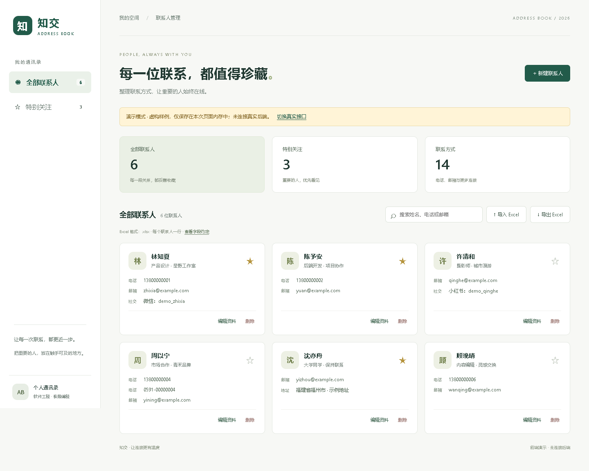
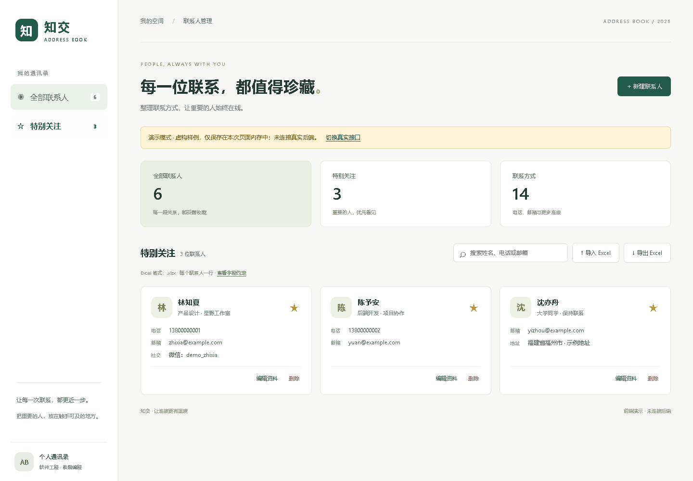
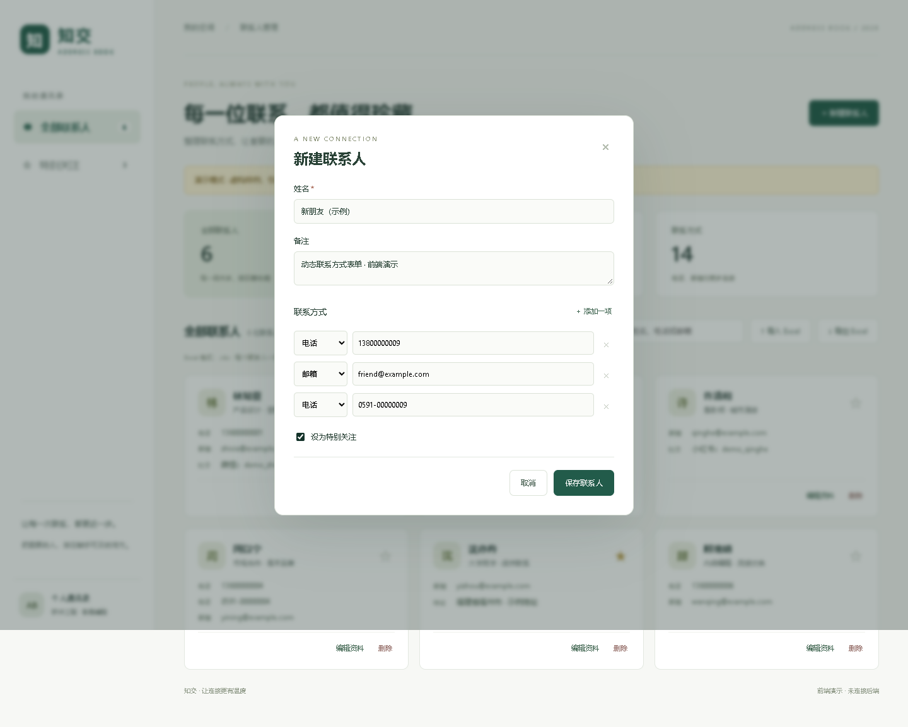
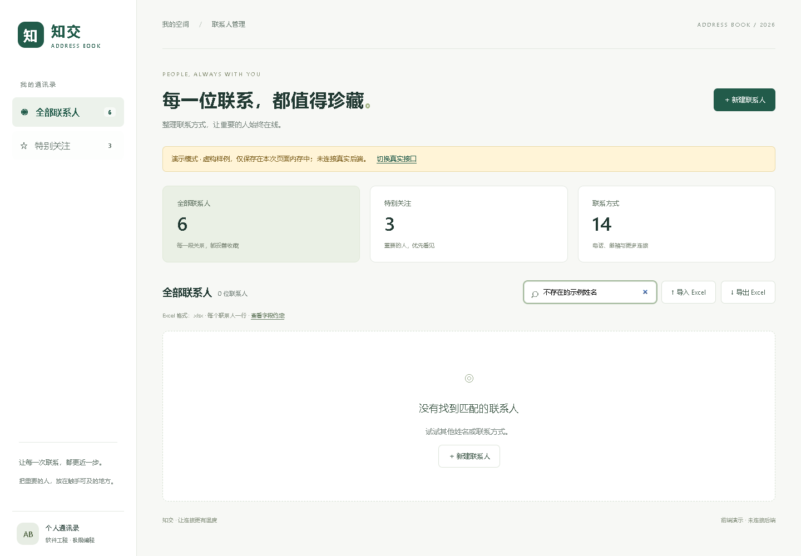
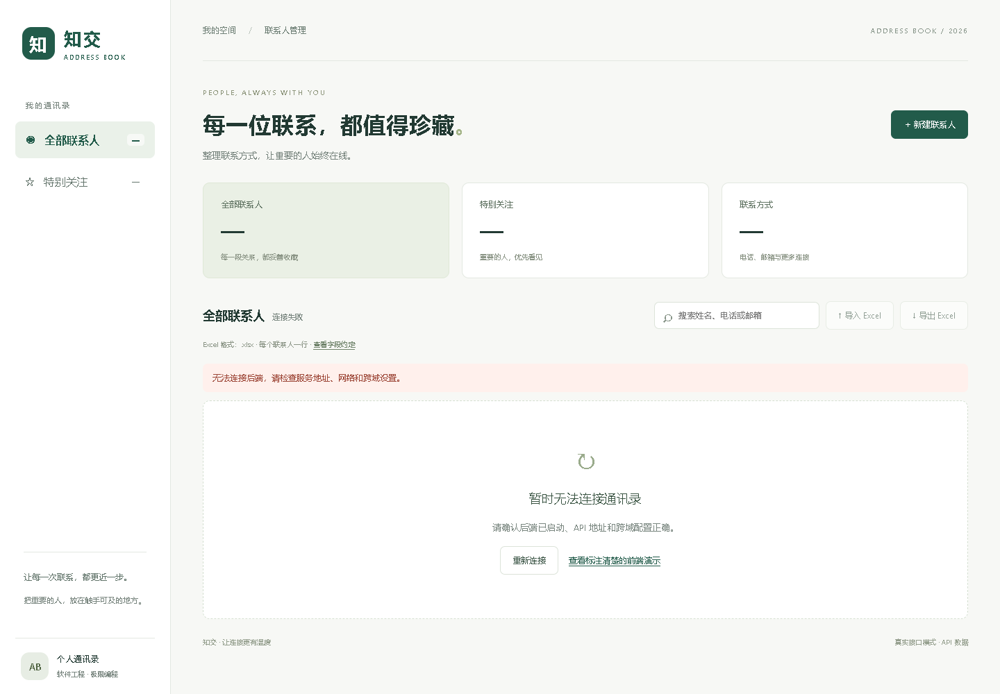

# 【姓名待填】极限编程作业：知交通讯录

> 本文是协作框架，所有占位符需在发布前补齐。项目内容可以共用，但每个人单独发布博客，分别填写本人 PSP、经历和实际工作。当前只有前端演示和接口桩验证，不可写成后端已完成。

| 项目 | 内容 |
| --- | --- |
| 所属课程 | Software Engineering (FZU–MU) |
| 团队名称 | 【共同填写】 |
| 作业要求 | [Extreme Programming](https://bbs.csdn.net/topics/620593436) |
| 作业目标 | 实现收藏、多联系方式、Excel 导入导出，实践前后端分工及 Git 协作 |
| 其他参考资料 | 【各人填写实际使用资料】 |

## 目录

1. 项目概览与完成情况
2. 技术栈与模块划分
3. Git 协作与提交记录
4. 功能实现
5. 验证与完整运行演示
6. 分工与贡献比例
7. 合作困难及解决方法
8. 个人 PSP
9. 总结与参考资料

## 1. 项目概览与完成情况

**【前端提供】** 名称、界面截图和交互范围。
**【后端提供】** 实际后端运行状态、部署地址。
**【共同确认】** 功能通过真实联调的情况。

- 项目：[address-book](https://github.com/linblackchen-code/address-book)
- 代码规范：[CODING_STANDARDS.md](https://github.com/linblackchen-code/address-book/blob/main/docs/CODING_STANDARDS.md)
- 公网地址：【有则填写，没有则如实说明未完成】
- 前端 PR：【填写真实链接】
- 最终 Release：【发布后填写】

| 要求 | 当前阶段 | 最终证据 |
| --- | --- | --- |
| 页面样式 | 前端已实现，桌面和手机已检查 | 页面截图 |
| 收藏联系人 | 前端已实现，真实联调待完成 | 【收藏和刷新后状态】 |
| 多种联系方式 | 前端动态表单已实现 | 【实际保存并重新读取】 |
| Excel 导入导出 | 前端 HTTP 流程已用测试桩验证 | 【实际服务导入导出及多值往返】 |
| 云部署（选做） | 【待填】 | 【公网地址】 |

前端阶段演示图，黄色提示表示未连接后端：

CSDN 发布时应上传图片并替换地址。

## 2. 技术栈与模块划分

**【前端提供】** HTML/CSS/JavaScript、fetch、响应式布局及文件职责。
**【后端提供】** 实际框架、版本、SQLite 数据模型、Excel 处理及运行方式，确认是否采用 FastAPI/openpyxl。
**【共同提供】** 最终接口和 Excel 格式。

浏览器负责交互，经 HTTP 调用后端；后端负责独立校验、持久化和 Excel。
接口建议稿：[API_CONTRACT.md](API_CONTRACT.md)，正式博客需说明最终确认结果。

## 3. Git 协作与提交记录

**【前端提供】** 本人提交次数、代表性提交链接、PR 与 GitHub 历史截图。
**【后端提供】** 本人提交次数、代表性提交链接、PR 与 GitHub 历史截图。
**【共同确认】** 统计口径与截图日期。

| 成员 | 职责 | 实际 commit 次数 | 代表性提交 |
| --- | --- | --- | --- |
| 【前端姓名】 | 前端 | 【按 GitHub 统计】 | 【链接】 |
| 【后端姓名】 | 后端 | 【按 GitHub 统计】 | 【链接】 |

【插入 GitHub Commits 页面截图，覆盖双方记录。】
仓库总提交数不等于个人编码次数；初始化文档、合并与功能提交应如实区分。
描述实际分支/PR 流程，前端本次在 feat/frontend 开发。课程起始仓库的 Fork 要求需要另行核实，不把新建仓库写成已 Fork。

## 4. 功能实现

### 4.1 页面和联系人管理

**【前端提供】** 卡片与统计、搜索、新建/编辑表单、删除确认、手机适配；说明 textContent 展示用户输入。
**【后端提供】** 查询、创建、修改、删除 API 与数据存储。
**【共同补证据】** 真实 API 新增并刷新仍可见的结果。

### 4.2 收藏联系人

**【前端提供】** 星标、特别关注入口、成功后刷新、失败反馈。
**【后端提供】** is_favorite 持久化、PATCH 设置指定状态的实现。
**【共同补证据】** 真实收藏后刷新仍保留。

### 4.3 多种联系方式

**【前端提供】** 动态增删行、类型选择、同类型多项、必填与邮箱格式校验。
**【后端提供】** 一对多结构、保存和更新规则、独立字段校验。
**【共同补证据】** 两个电话及一个邮箱实际保存后重新读取。

### 4.4 Excel 导入导出

**【前端提供】** .xlsx/5 MiB 检查、FormData 的 file 字段、结果反馈、刷新和 Blob 下载。
**【后端提供】** Excel 解析生成、字段映射、多值序列化、无效行和重复导入政策、事务；实际导出文件及模板。
**【共同补证据】** 实际 Excel 打开截图、导入后联系人、同类型多值和电话前导零保留；说明导出全部联系人。

【插入真实 Excel 文件截图和真实导入结果。】
现有 09-contract-import-feedback.png 是接口桩反馈，不是实际 Excel 解析证据。contacts-template.xlsx 只是待确认格式夹具。

### 4.5 异常处理

**【前端提供】** 空白、搜索无结果、服务不可用、服务端验证错误、按钮恢复。
**【后端提供】** 错误码、文件和字段校验、数据库异常反馈。
**【共同确认】** 前端校验不能替代后端校验。

## 5. 验证与完整运行演示

**【前端提供】** [前端验证记录](FRONTEND_VERIFICATION.md)、截图及阶段演示视频。
**【后端提供】** 实际 API、数据库重启后持久化、Excel 往返及错误文件的验证记录。
**【共同提供】** 真实前后端完整运行视频和可访问链接，建议附关键时间点。

- [前端阶段视频](videos/frontend-demo.webm)：仅演示前端，不替代最终完整视频。
- 完整项目视频：【待共同录制并填写链接】。
- 真实联调结果：【待填，不能将测试桩通过写成真实后端通过】。

[证据索引和最终录制脚本](EVIDENCE.md)。

## 6. 分工与贡献比例

**【前端提供】** 实际页面、交互、验证和文档工作。
**【后端提供】** 实际接口、存储、Excel 和部署工作。
**【共同确认】** 共享工作及贡献比例，合计 100%。

| 成员 | 实际工作 | 比例 |
| --- | --- | --- |
| 【前端姓名】 | 【按实际填写】 | 【待评估】% |
| 【后端姓名】 | 【按实际填写】 | 【待评估】% |
| 合计 | | 100% |

## 7. 合作困难及解决方法

**【双方各提供】** 真实问题、原因、办法及验证。下表是提示，不代表已经发生。

| 实际问题 | 原因 | 解决办法 | 验证结果 | 参与者 |
| --- | --- | --- | --- | --- |
| 【如实际发生的字段不一致或跨域问题】 | 【待填】 | 【待填】 | 【待填】 | 【待填】 |

## 8. 个人 PSP

**【各人单独填写】** 使用本人预计和实际耗时，统一分钟；不要复制队友记录。若课程有固定模板，以课程模板为准；未事先记录预计值时如实说明。

| 阶段 | 预计（分钟） | 实际（分钟） |
| --- | --- | --- |
| 需求与计划 | 【待填】 | 【待填】 |
| 技术学习 | 【待填】 | 【待填】 |
| 设计与接口约定 | 【待填】 | 【待填】 |
| 编码 | 【待填】 | 【待填】 |
| 测试与联调 | 【待填】 | 【待填】 |
| 文档、截图和视频 | 【待填】 | 【待填】 |
| 总结复盘 | 【待填】 | 【待填】 |
| 合计 | 【求和】 | 【求和】 |

## 9. 总结与参考资料

**【各人单独填写】** 本人收获、代码理解、实际不足与改进；如使用 AI 辅助，按课程要求如实说明范围。

按实际使用保留参考：
- [MDN Fetch API](https://developer.mozilla.org/zh-CN/docs/Web/API/Fetch_API)
- [FastAPI 文件上传](https://fastapi.tiangolo.com/tutorial/request-files/)
- [openpyxl 教程](https://openpyxl.readthedocs.io/en/stable/tutorial.html)
- 【其他资料】

发布前确认：无占位符；截图与最终版本一致；链接与视频可访问；提交截图与次数齐全；个人 PSP 正确；比例合计 100%；提前发布预留审核时间。
