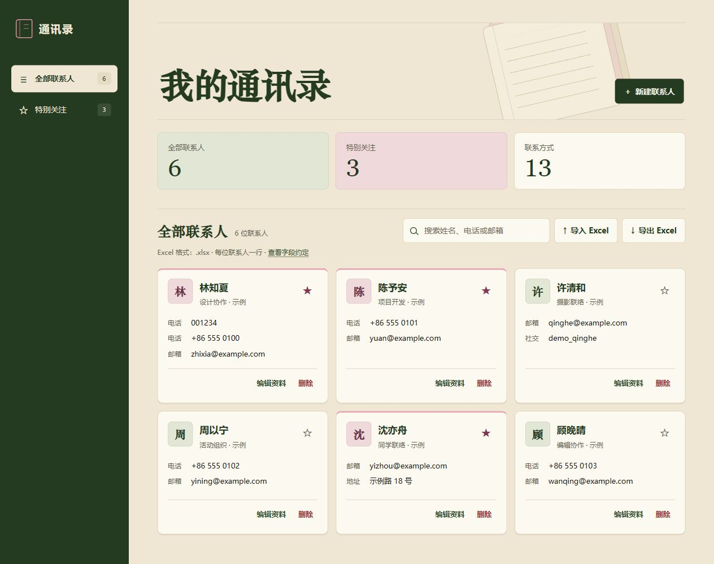
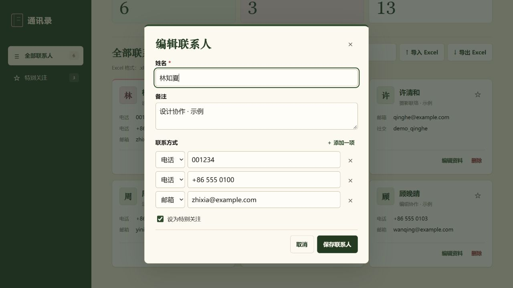
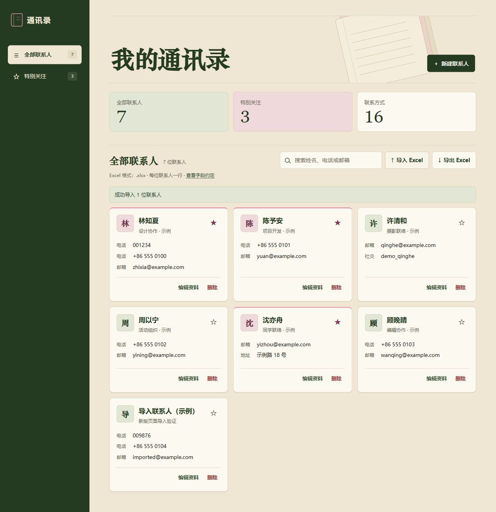
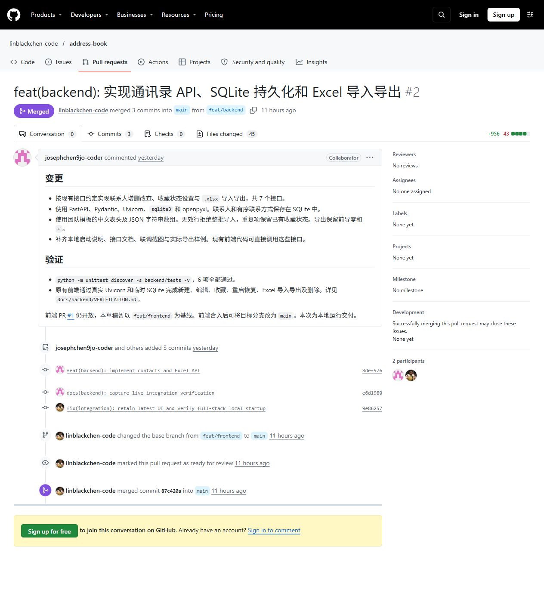

# BLGNB Extreme Programming: Address Book — Frontend Development by Junchen Lin

| Item | Details |
| --- | --- |
| Course | Software Engineering (FZU–MU) |
| Team | BLGNB |
| Assignment | [Extreme Programming](https://bbs.csdn.net/topics/620593436) |
| Objectives | Implement contact bookmarking, multiple contact methods, and Excel import/export through frontend–backend collaboration and Git-based development |
| Author | Junchen Lin (林俊晨), 832401117 — Frontend |
| Teammate | Ziyuan Chen (陈子元), 832401108 — Backend |
| References | [MDN Fetch](https://developer.mozilla.org/en-US/docs/Web/API/Fetch_API), [FastAPI](https://fastapi.tiangolo.com/), [openpyxl](https://openpyxl.readthedocs.io/en/stable/tutorial.html), [Nginx](https://nginx.org/en/docs/) |

## Contents

1. [Project Overview](#1-project-overview)
2. [Responsibilities and Contributions](#2-responsibilities-and-contributions)
3. [Technical Approach and Frontend Work](#3-technical-approach-and-frontend-work)
4. [Feature Implementation](#4-feature-implementation)
5. [Git Collaboration](#5-git-collaboration)
6. [Integration, Deployment, and Verification](#6-integration-deployment-and-verification)
7. [Collaboration Issues and Solutions](#7-collaboration-issues-and-solutions)
8. [Personal PSP](#8-personal-psp)
9. [Personal Reflection](#9-personal-reflection)

## 1. Project Overview

Our project is an address book with a separate frontend and backend. It supports contact management, bookmarking, multiple contact methods, and Excel import/export. The frontend is connected to the actual backend, and the application is deployed on an Alibaba Cloud server.

- GitHub repository: [https://github.com/linblackchen-code/address-book](https://github.com/linblackchen-code/address-book)
- Live application: [http://47.114.63.69/address-book/](http://47.114.63.69/address-book/)
- [API documentation](http://47.114.63.69/address-book/docs)
- [Coding standards](https://github.com/linblackchen-code/address-book/blob/main/docs/CODING_STANDARDS.md)
- [Frontend PR #1](https://github.com/linblackchen-code/address-book/pull/1) and [backend PR #2](https://github.com/linblackchen-code/address-book/pull/2), both merged.

The interface combines a dark green sidebar with a light content area. Contact cards support both desktop and mobile layouts. The screenshots use fictional contacts and were captured with a real backend connection. The Excel screenshot shows an actual exported workbook.

## 2. Responsibilities and Contributions

| Member | Main Responsibilities | Contribution |
| --- | --- | --- |
| Junchen Lin | Frontend layout and styling, contact interactions, bookmark filtering, dynamic contact-method forms, Excel upload/download interface, responsive design, and frontend error handling | 50% |
| Ziyuan Chen | Backend APIs, validation, SQLite persistence, contact and contact-method models, bookmark logic, Excel parsing/generation, and backend verification | 50% |
| Shared work | API agreement, frontend–backend integration, functional verification, checking submission materials, and preparing shared blog content | Included within each member's 50% |
| Total | | 100% |

We divided the main implementation into frontend and backend work and jointly checked the interfaces and overall behavior. Each member's blog includes their own work, PSP table, and reflection. The project introduction, screenshots, and shared technical content may be reused. Commit counts document the development process and do not directly determine contribution percentages.

## 3. Technical Approach and Frontend Work

The frontend reuses the HTML, CSS, JavaScript, and Fetch API approach from my previous calculator project. Keeping a familiar stack allowed me to focus on the address-book features, data exchange, and integration within the available time. Ziyuan implemented the backend with FastAPI, Pydantic, Uvicorn, SQLite, and openpyxl.

With assistance from development tools, I was responsible for the following frontend work:

| Area | Completed Work |
| --- | --- |
| Page design | Contact cards, navigation, statistics, search, buttons, and dialogs; simplifying the title and removing unnecessary explanatory text based on feedback |
| Contact operations | Creation, editing, deletion confirmation, validation, saving states, refreshing after success, and failure feedback |
| Bookmarks and search | Bookmark state, the bookmarked-contact view, and searching names, notes, and contact details |
| Multiple contact methods | Adding and removing rows for phone, email, social account, address, and other types, including repeated entries of the same type |
| Excel interactions | File selection, extension and size checks, upload, download, and import-result feedback |
| Mobile support | Adapting navigation, toolbars, cards, and dialogs to avoid horizontal overflow |
| Shared delivery | Supporting integration and verification, checking the integrated interface, and preparing screenshots, videos, and shared blog materials |

The frontend separates structure, styling, interactions, and communication. `index.html` defines the page, `styles.css` controls the layout, `app.js` manages state and events, `api.js` handles HTTP requests, and `config.js` sets the API address. The frontend accesses data through APIs rather than connecting directly to the database.

## 4. Feature Implementation

### 4.1 Contact Management and Interface States

Each contact card displays the name, notes, and all associated contact details. Creation and editing share one form, while deletion requires confirmation. After a successful save, the frontend requests the contact list again so that the displayed result reflects the data actually stored by the backend.

Search matches names, notes, and contact details within the complete list. The interface distinguishes an empty address book, no search results, and connection failures. User-entered text is rendered with `textContent` so that it is treated as text rather than executable HTML.

### 4.2 Bookmarking Contacts

The frontend displays a star button and provides a dedicated bookmarked-contact view. Clicking the star sends an explicit `is_favorite` Boolean value. The list refreshes after the backend saves the change. If the request fails, an error is displayed instead of presenting the operation as successfully saved.

Bookmark filtering can be combined with search. Total and bookmarked-contact counts are calculated from the actual list.

### 4.3 Multiple Contact Methods

The form uses dynamic rows containing a type selector and a value field. Users can add or remove rows, and the same type can appear more than once—for example, two phone numbers and one email address for a single contact.

The frontend checks for empty values and performs basic email validation. The backend validates the fields independently. A one-to-many relationship between contacts and contact methods stores the data, with a `position` field preserving the order.

### 4.4 Excel Import and Export

My responsibility was the browser-side file interaction. For import, users select an `.xlsx` file. The frontend checks the extension, rejects empty files, enforces a 5 MiB limit, and uploads the file through the `file` field of `FormData`. On success, it displays the backend's message and refreshes the list. Duplicate records and invalid files receive clear feedback.

For export, the frontend receives the binary file generated by the backend and uses a `Blob` and a download link to save it as `contacts.xlsx`. The backend handles workbook parsing and generation; the frontend handles transfer and user feedback.

Each contact occupies one row, with each information type in a separate column. Multiple values of the same type are stored as JSON string arrays, preserving leading zeros, plus signs, and Chinese text. Export includes all contacts regardless of the current search filter.

The screenshot shows an actual exported workbook opened in Microsoft Excel using fictional contacts. The [sample workbook](https://github.com/linblackchen-code/address-book/blob/main/docs/submission/contacts-sample.xlsx) is available for download.

### 4.5 Error Handling

`api.js` centralizes network errors and unsuccessful HTTP responses and supports backend error formats such as `message` and `detail`. Relevant buttons are disabled during saving or file operations and restored afterward.

Frontend checks provide prompt feedback, while the backend independently validates the actual content. For example, a corrupted workbook is rejected even if its filename ends in `.xlsx`, and the frontend displays the returned error.

## 5. Git Collaboration

The frontend was developed on `feat/frontend` and the backend on `feat/backend`. Changes were merged into `main` through pull requests while preserving the original commit history. The visual redesign was completed on `style/editorial-forest-frontend` and merged through [PR #3](https://github.com/linblackchen-code/address-book/pull/3).

The following counts are grouped by GitHub account up to **a500e10 on November 17, 2026**. They include initialization, features, tests, documentation, deployment, and merge commits.

| Member | GitHub Account | All Commits, Including Merges | Non-merge Commits |
| --- | --- | ---: | ---: |
| Junchen Lin | linblackchen-code | 15 | 12 |
| Ziyuan Chen | josephchen9jo-coder | 7 | 7 |
| Total | | 22 | 19 |

Non-merge commits also include documentation, tests, and deployment work, so they are not equivalent to feature-coding commits. Different author display names associated with the same account are grouped together. The counts refer to the [main history at a500e10](https://github.com/linblackchen-code/address-book/commits/a500e10408999faa19557c919d77726db9e16366/).

Frontend development progressed through layout and API agreement, interaction implementation, verification, and documentation. Later work simplified the interface and completed integration, deployment, and submission materials. Backend commits cover the APIs, Excel implementation, and integration verification.

## 6. Integration, Deployment, and Verification

We jointly checked contact fields, request methods, and response formats, then verified that browser operations matched the actual backend data. Verification covered creation, editing, deletion, bookmarks, multiple contact methods, Excel import/export, duplicate handling, errors, and mobile layouts. Contacts and bookmark states were retained after an actual service restart.

The project runs on the same Alibaba Cloud server as the calculator. The calculator uses the root path and backend port 8000; the address book uses `/address-book/` and a separate backend on port 8001. They have independent services and databases, with Nginx routing requests by path.

**Application demonstration (2 minutes 30 seconds)**

<video controls preload="metadata" poster="submission/01-new-desktop.jpg" src="submission/address-book-demo.mp4"></video>

Recorded from the deployed application and covering contact management, bookmarks, and Excel import/export.
- [Public deployment verification](https://github.com/linblackchen-code/address-book/blob/main/docs/cloud/VERIFICATION.md).
- All six backend regression tests passed.

## 7. Collaboration Issues and Solutions

| Issue | Solution | Verified Result |
| --- | --- | --- |
| Import feedback must explain both newly added records and skipped duplicates | Display a consistent message using the returned `imported`, `skipped`, and `message` fields | Normal imports and repeated imports produce different feedback |
| The existing calculator's API path and upload limit could not simply be reused | Give the address book its own backend port and path, and configure the upload limit in its API location | Excel uploads work while the calculator continues operating normally |

Collaboration requires checking the combined application as well as completing individual modules. Fields, feedback messages, interface versions, and deployment paths must remain consistent.

## 8. Personal PSP

Time is measured in minutes.

| PSP Phase | Planned Time | Actual Effort (Estimated) |
| --- | ---: | ---: |
| Reading requirements and planning | 30 | 40 |
| Technical preparation and reusing calculator experience | 30 | 30 |
| Page design, module division, and API agreement | 45 | 50 |
| Frontend coding and interface revisions | 180 | 200 |
| Testing, integration, and deployment verification | 90 | 110 |
| Documentation, screenshots, videos, and shared blog content | 90 | 120 |
| Personal reflection and review | 15 | 20 |
| Total | **480 (8 hours)** | **570 (9 hours 30 minutes)** |

## 9. Personal Reflection

This project reinforced that frontend development must handle the relationship between user actions and backend results. Whether a bookmark is actually saved, a duplicate import receives a clear explanation, or a button recovers after a failed request affects the reliability of the application.

Compared with the calculator, the address book introduced dynamic forms and file interactions. Reusing familiar technologies allowed me to concentrate on those features, while centralizing requests in `api.js` made the page logic easier to maintain. Multiple contact methods also highlighted the importance of data structures: the form, backend, and Excel format must all represent the same values completely.

For frontend–backend collaboration, agreeing on fields and response formats and then inspecting actual responses is more useful than judging the interface alone. Integration requires consistent interfaces and APIs; deployment must account for other applications' ports, paths, and upload limits. Screenshots, videos, and documentation should also reflect the final version.
