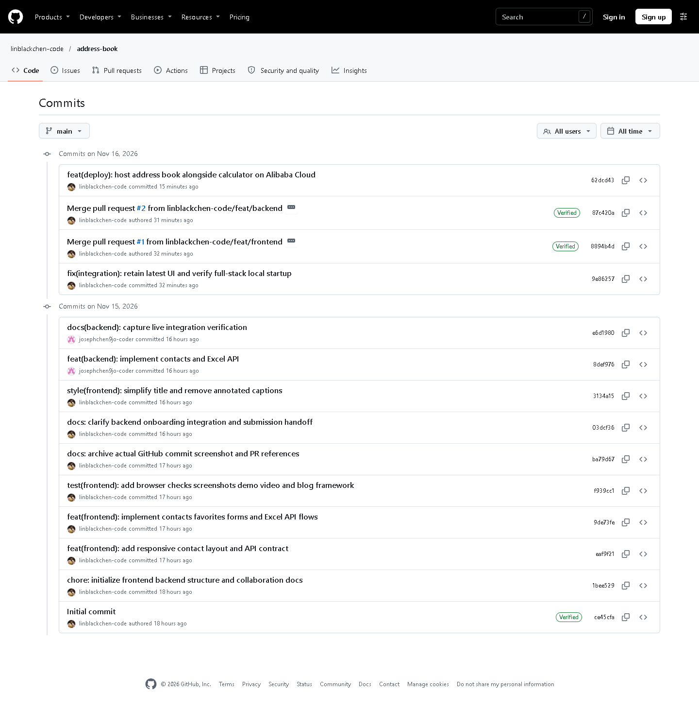

# BLGNB 团队极限编程作业：通讯录——林俊晨的前端开发记录

| 项目 | 内容 |
| --- | --- |
| 所属课程 | Software Engineering (FZU–MU) |
| 团队名称 | BLGNB |
| 作业要求 | [Extreme Programming](https://bbs.csdn.net/topics/620593436) |
| 作业目标 | 实现联系人收藏、多种联系方式和 Excel 导入导出，通过前后端分工、Git 协作及联调完成可运行的通讯录 |
| 本文作者 | 林俊晨，负责前端 |
| 合作成员 | 陈子元，负责后端 |
| 其他参考资料 | [MDN Fetch](https://developer.mozilla.org/zh-CN/docs/Web/API/Fetch_API)、[FastAPI](https://fastapi.tiangolo.com/)、[openpyxl](https://openpyxl.readthedocs.io/en/stable/tutorial.html)、[Nginx](https://nginx.org/en/docs/) |

## 目录

1. [项目概览](#1-项目概览)
2. [分工与贡献比例](#2-分工与贡献比例)
3. [技术方案和前端工作](#3-技术方案和前端工作)
4. [功能实现](#4-功能实现)
5. [Git 协作](#5-git-协作)
6. [联调、部署和验证](#6-联调部署和验证)
7. [合作问题及解决方法](#7-合作问题及解决方法)
8. [个人 PSP](#8-个人-psp)
9. [个人总结](#9-个人总结)

## 1. 项目概览

本次项目是一个前后端分离的通讯录，支持联系人管理、收藏、多种联系方式及 Excel 导入导出。页面已经连接实际后端，并部署到阿里云服务器。

- [GitHub 仓库](https://github.com/linblackchen-code/address-book)
- [通讯录公网地址](http://47.114.63.69/address-book/)
- [API 文档](http://47.114.63.69/address-book/docs)
- [代码规范](https://github.com/linblackchen-code/address-book/blob/main/docs/CODING_STANDARDS.md)
- [前端 PR #1](https://github.com/linblackchen-code/address-book/pull/1)、[后端 PR #2](https://github.com/linblackchen-code/address-book/pull/2)：均已合并。
- GitHub Release：尚未发布，发布后补充版本链接。

新版桌面首页、手机预览及第 4 节的功能图均使用虚构联系人，在本地连接真实后端后采集。Excel 导出图展示实际工作簿中的内容。

## 2. 分工与贡献比例

| 成员 | 主要分工 | 贡献比例 |
| --- | --- | --- |
| 林俊晨 | 前端页面与样式、联系人交互、收藏筛选、动态联系方式表单、Excel 上传下载界面、响应式布局和前端异常处理 | 50% |
| 陈子元 | 后端 API、数据校验、SQLite 持久化、联系人及联系方式数据模型、收藏逻辑、Excel 解析生成与后端验证 | 50% |
| 共同工作 | 接口约定、前后端联调、功能验收、材料核对、共同博客内容整理 | 包含在双方各自的 50% 内 |
| 合计 | | 100% |

我们按前端和后端划分主要任务，接口和功能效果由双方共同核对。各自发布的博客保留自己的工作说明、PSP 和总结，项目介绍、运行截图及公共技术内容可以共用。提交次数用于说明开发过程，不直接换算成贡献比例。

## 3. 技术方案和前端工作

前端沿用此前计算器项目熟悉的 HTML、CSS、JavaScript 和 fetch，不增加新的前端框架。这样可以把有限时间集中在通讯录功能、数据交互和联调上。后端由陈子元使用 FastAPI、Pydantic、Uvicorn、SQLite 和 openpyxl 实现。

在开发辅助工具支持下，我的工作范围主要是：

| 工作 | 实际完成内容 |
| --- | --- |
| 页面设计 | 联系人卡片、导航、统计、搜索栏、操作按钮和弹窗；根据页面反馈删除多余说明文字，简化左上角标题 |
| 联系人操作 | 新建、编辑和删除确认，表单校验、保存中状态、成功刷新及失败反馈 |
| 收藏与搜索 | 星标状态、特别关注列表，以及姓名、备注和联系方式搜索 |
| 多联系方式 | 动态增删联系方式行，支持电话、邮箱、社交账号、地址和其他类型，同类型可有多个值 |
| Excel 交互 | 文件选择、扩展名及体积检查、上传、下载和导入结果展示 |
| 手机适配 | 调整侧栏、工具栏、卡片和弹窗，避免小屏横向溢出 |
| 共同交付 | 配合接口联调和验收，核对整合后的界面，整理截图、录像及共同博客材料 |

前端将界面结构、样式、交互和通信分开管理。index.html 定义页面；styles.css 负责布局；app.js 管理状态、渲染和事件；api.js 统一处理 HTTP；config.js 管理 API 地址。页面通过 API 使用后端数据，不直接访问数据库。

## 4. 功能实现

### 4.1 联系人管理与界面状态

联系人以卡片展示，包含姓名、备注及全部联系方式。新建和编辑共用表单，删除前弹出确认框。保存成功后重新请求联系人列表，使页面反映后端实际保存的结果。

搜索在完整联系人列表上进行，匹配姓名、备注和联系方式。无联系人、没有搜索结果和无法连接服务分别显示相应提示，避免空白页面让用户无法判断状态。姓名和备注等用户内容通过 textContent 写入，避免被当作 HTML 执行。

### 4.2 收藏联系人

前端显示星标，并提供“特别关注”入口。点击星标时发送明确的 is_favorite 布尔值，后端保存后再刷新列表。请求失败时显示错误，不把失败的操作表现为已保存。

收藏筛选可以和搜索一起使用；联系人总数和收藏数根据实际列表更新。

### 4.3 多种联系方式

表单采用“类型＋内容”的动态行，用户可以添加或移除联系方式。相同类型可以重复，例如一个联系人拥有两个电话和一个邮箱。

前端检查内容是否为空，并对邮箱进行基础格式校验；后端仍独立检查所有字段。数据由联系人表和联系方式表的一对多结构保存，顺序由 position 字段记录。

### 4.4 Excel 导入导出

我负责浏览器端的文件交互。导入时选择 .xlsx 文件，前端检查扩展名、空文件及 5 MiB 上限，通过 FormData 的 file 字段上传。成功后展示后端返回的信息并刷新联系人列表；重复记录跳过和无效文件均有明确提示。

导出时接收后端生成的二进制文件，使用 Blob 和下载链接保存为 contacts.xlsx。后端负责真正的 Excel 解析和生成，前端不以 CSV 冒充 Excel 文件。

Excel 中每个联系人占一行、每类信息占一列，同类多个联系方式使用 JSON 字符串数组保存，保留电话前导零、+ 和中文。导出包含全部联系人，不受页面当前搜索条件限制。

上图是在 Microsoft Excel 中打开实际导出工作簿的截图，使用虚构联系人。[Excel 样例](submission/contacts-sample.xlsx)可下载打开。

### 4.5 异常处理

api.js 集中处理网络连接失败和非成功 HTTP 状态，并兼容后端 message、detail 等错误格式。保存和文件操作期间禁用相应按钮，结束后恢复。

前端校验用于及时反馈，不能代替后端校验。例如损坏文件即使扩展名为 .xlsx，后端仍会拒绝并返回错误，前端将错误显示给用户。

## 5. Git 协作

前端在 feat/frontend 分支开发，后端在 feat/backend 分支开发，通过 PR 合入 main，保留双方原始提交记录。

下表使用已保存截图对应的统计快照 **62dcd43（2026-11-16）**。之后的材料和博客整理提交不包含在这个快照中。

| 成员 | GitHub 账号 | 全部提交，含 merge | 非 merge 提交 |
| --- | --- | ---: | ---: |
| 林俊晨 | linblackchen-code | 12 | 10 |
| 陈子元 | josephchen9jo-coder | 2 | 2 |
| 合计 | | 14 | 12 |

非 merge 提交也包含初始化、文档、测试和部署，不能当作纯功能编码次数；同一账号的不同作者显示名称已归并。详细记录见 [Git 统计](GIT_CONTRIBUTIONS.md)。

前端阶段提交包括页面及接口约定、交互实现、验证与博客框架，之后根据反馈继续简化页面并完成整合、部署和材料整理。后端提交包含接口和 Excel 实现以及真实联调验证。

当前仓库为新建仓库；如果课程另有指定的 Fork 起始仓库，需要按老师要求核实，不能将新建仓库写成已完成 Fork。

## 6. 联调、部署和验证

我们共同核对联系人字段、请求方式和返回格式，在真实 API 模式中验证前端操作与后端数据是否一致。验证覆盖新增、编辑、删除、收藏、多联系方式、Excel 导入导出、重复处理、错误反馈和手机布局。实际重启服务后，联系人和收藏状态仍然保留。

项目已部署到与计算器相同的阿里云服务器。计算器使用根路径及后端 8000，通讯录使用 /address-book/ 路径及独立后端 8001。数据库和服务独立，Nginx 按路径转发。

- [真实云服务操作录像](submission/cloud-walkthrough.webm)：通过 SSH 隧道访问同一云服务，无模拟响应、无配音。
- [本地完整联调录像](integration/full-stack-demo.webm)：包含实际服务重启后的持久化验证。
- [公网验收记录](cloud/VERIFICATION.md)。
- 后端已有 6 项自动回归测试通过。

博客发布时需要上传图片和视频，并把仓库相对链接替换为可访问的媒体地址。

## 7. 合作问题及解决方法

| 项目中遇到的问题 | 处理方法 | 验证结果 |
| --- | --- | --- |
| 整合时后端分支带回旧版前端文字和截图 | 对比双方改动，保留已经确认的最新界面，再合入后端功能 | 页面保持简化后的标题和文案，真实接口仍可使用 |
| 前后端可能对“导入成功”和“重复跳过”的理解不同 | 按接口返回的 imported、skipped 和 message 统一展示反馈 | 实际导入与重复导入有不同的提示 |
| 同服务器已有计算器，API 路径和上传限制不能直接照搬 | 为通讯录使用独立后端端口和路径，并在其 API location 单独调整上传限制 | 通讯录可以上传 Excel，计算器原有服务保持正常 |

这些问题说明，协作不仅需要分别完成自己的模块，还要检查组合后的行为。共同内容在博客中如实记述，个人部分不将队友的实现写成自己独立完成。

## 8. 个人 PSP

我此前做过同类原生前端和 fetch 项目，因此预算不从零学习框架，而将时间集中在动态表单、文件交互、联调和交付材料上。作业在两天左右完成，按分阶段投入约 8–10 小时规划。

**本次未逐项计时。下表“计划”是事后复盘的参考预算，“实际投入”是按项目范围和已有基础作出的回顾估算，并非计时记录。** 单位为分钟；如果能回忆出更准确的投入，应据实修订。

| PSP 阶段 | 计划预算（回顾性规划） | 实际投入（回顾估算） |
| --- | ---: | ---: |
| 需求阅读与任务计划 | 30 | 40 |
| 技术准备与计算器经验复用 | 30 | 30 |
| 页面设计、模块划分与接口约定 | 45 | 50 |
| 前端编码与界面修改 | 180 | 200 |
| 测试、前后端联调与部署验收 | 90 | 110 |
| 文档、截图、录像与共同博客内容 | 90 | 120 |
| 个人总结与复盘 | 15 | 20 |
| 合计 | **480（8 小时）** | **570（9 小时 30 分钟）** |

回顾估算比预算增加 90 分钟，主要预留给整合后的界面核对、真实 Excel 流程验证和材料整理。这些并不是功能编码之外可以省略的工作；后续项目应在开始时记录实际用时，使 PSP 对估算改进更有帮助。

## 9. 个人总结

这次项目让我进一步认识到，前端的工作不仅是把页面显示出来，还要完整处理用户操作和后端结果之间的关系。收藏状态是否真正保存、重复导入是否有清楚提示、请求失败后按钮是否恢复，都会影响程序是否可靠可用。

相比此前的计算器，通讯录增加了动态表单和文件交互。我在复用原生技术的基础上，把接口请求集中到 api.js，让页面逻辑更容易维护。多项联系方式也让我更加注意数据结构：界面能添加多行，后端和 Excel 才有依据完整保存这些值。

前后端协作中，先约定字段和返回格式，再检查实际响应，比仅按页面效果判断更有效。整合时还需要检查旧界面是否被带回，部署时需要考虑同服务器已有项目的端口、路径和上传限制。项目完成后，截图、视频和文档也应对应最终版本。

本次不足是没有从开始就逐项记录时间，因此 PSP 只能使用明确标注的回顾估算。后续我会按需求、编码、联调和材料整理分别计时，并在每个阶段保存验证结果，使个人工作记录更准确。对于辅助工具生成或修改的代码，也需要自己理解、运行和检查，确保能够解释具体实现及其限制。
