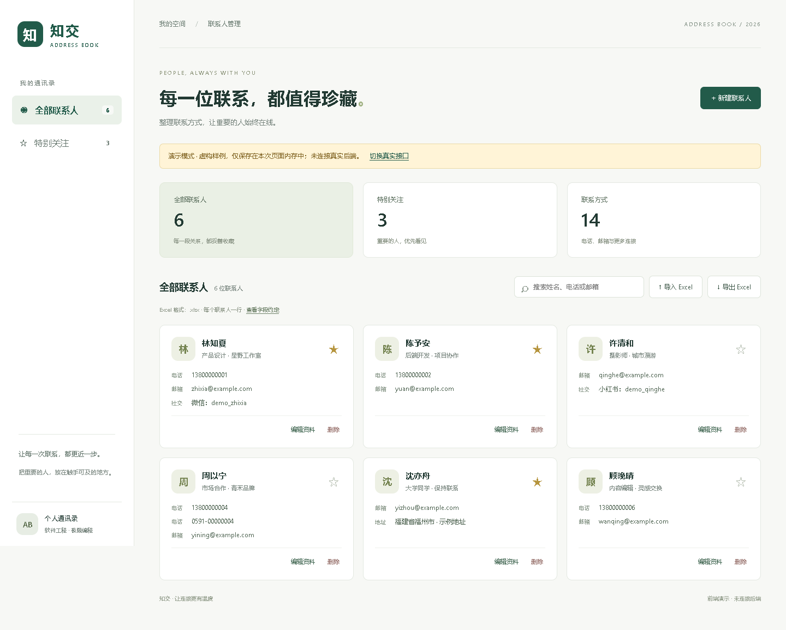

# 截图与提交材料索引

## 云端材料（2026-11-16）

[公网访问](http://47.114.63.69/address-book/) · [部署说明](../deployment/ubuntu/README.md) · [公网验收](cloud/VERIFICATION.md)。cloud/ 下的 Excel 来自真实云服务。自动浏览器拦截公网 HTTP 页面，公网截图及录像尚未补录；现有本地真实联调录像仍在 integration/。

## 真实整合材料（2026-11-16）

前后端已经在本机真实运行并验证。见 [整合验证](integration/VERIFICATION.md)、[完整操作录像](integration/full-stack-demo.webm)、[实际导出工作簿](integration/contacts-export.xlsx)。integration/ 中的截图对应实际 API；下方前端阶段图片仍为演示或测试桩。

## 已生成的前端材料

图片中的黄色提示明确标注演示模式或 HTTP 测试桩，全部为虚构数据。

| 文件 | 内容 | 用途 |
| --- | --- | --- |
| screenshots/01-demo-desktop.png | 桌面主页 | 页面设计 |
| screenshots/02-demo-favorites.png | 特别关注筛选 | 收藏交互 |
| screenshots/03-demo-search-empty.png | 无匹配联系人 | 搜索与空状态 |
| screenshots/04-demo-multiple-methods.png | 多电话、邮箱动态表单 | 多联系方式 |
| screenshots/05-demo-excel-boundary.png | 演示模式拒绝假装导出成功 | 当前完成边界 |
| screenshots/06-demo-mobile.png | 手机完整页面 | 响应式设计 |
| screenshots/07-demo-mobile-form.png | 手机表单 | 手机适配 |
| screenshots/08-api-unavailable.png | 后端不可用 | 异常处理 |
| screenshots/09-contract-import-feedback.png | 测试桩导入反馈 | 仅证明前端反馈，联调后替换 |
| screenshots/10-github-frontend-commits.png | GitHub PR #1 真实页面截图，显示前三阶段 3 次提交 | 提交历史证据；后续材料归档提交另计，最终提交前更新双方截图 |
| videos/frontend-demo.webm | 页面、筛选、增删改、多联系方式及边界提示 | 前端阶段演示，不能替代完整项目视频 |
| fixtures/contacts-template.xlsx | 有效 Excel 工作簿 | 格式建议夹具，非后端导出结果 |

前端 PR：[PR #1](https://github.com/linblackchen-code/address-book/pull/1)，开发分支 feat/frontend。页面截图取自真实 GitHub，未重绘或修改内容。

前三阶段：eaf9f21 页面及接口、9de73fe 交互实现、f939cc1 验证及博客框架。后续截图归档为独立提交；个人统计以最终 GitHub 记录为准。

## 最终必须补齐

| 负责人 | 材料 | 要求 |
| --- | --- | --- |
| 前端 | 真实 API 页面截图 | 连接实际后端，不能以模拟截图证明持久化 |
| 后端 | 数据结构、接口和运行说明 | 确认并落实 API_CONTRACT.md |
| 后端 | Excel 导入导出证据 | 实际服务往返，保留同类型多值、前导零及全部字段 |
| 共同 | 完整运行视频 | 前后端实际运行、持久化、真正导入导出与错误反馈 |
| 各人 | GitHub 提交历史截图及次数 | GitHub Commits 页，区分各人真实记录 |
| 各人 | PSP、个人工作和反思 | 实际填写，不编造时间 |
| 共同 | PR 与最终 Release | 提供可访问链接 |
| 后端/部署负责人 | 公网地址（选做） | localhost 不算 |

## 最终完整视频建议脚本

1. 展示仓库、真实 API 页面与技术栈。
2. 新建联系人，添加两个电话和一个邮箱，保存、刷新，验证数据保留。
3. 编辑备注，收藏，切换特别关注，搜索联系方式。
4. 导出全部联系人，打开 Excel，展示每人一行、每类信息一列及多值。
5. 使用正确格式文件导入，展示新增联系人及完整信息。
6. 展示无效文件或无效字段的反馈，展示手机布局。
7. 后端重启后再次读取以验证持久化；如有部署，展示公网地址。

使用虚构数据。博客发布时上传图片和视频，仓库相对图片路径不会自动转为 CSDN 图片链接。
