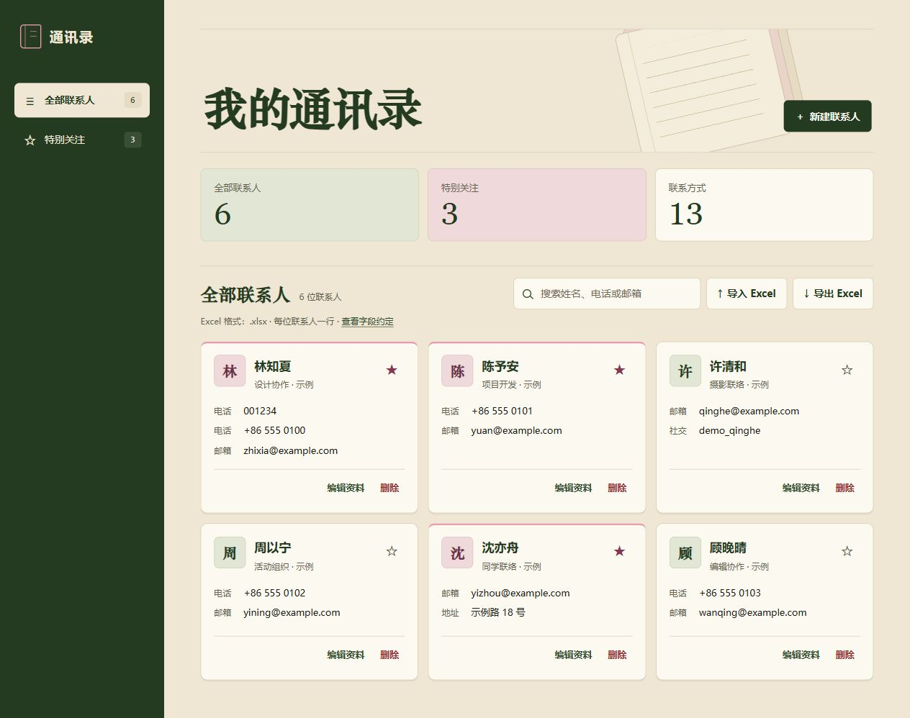
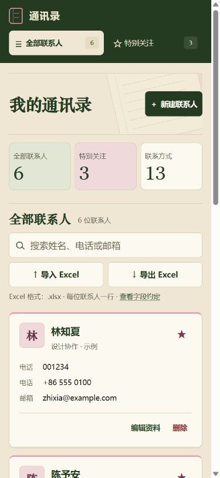
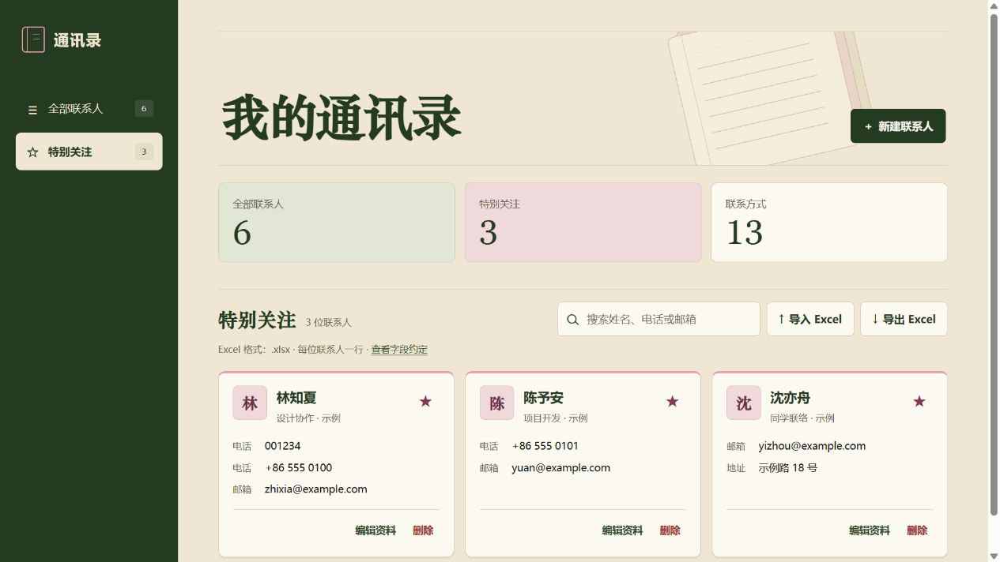
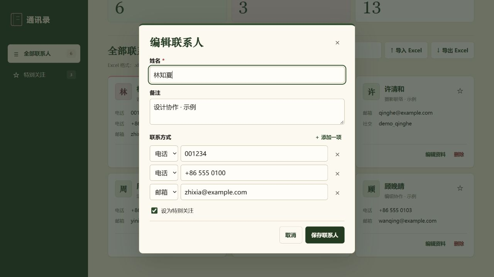
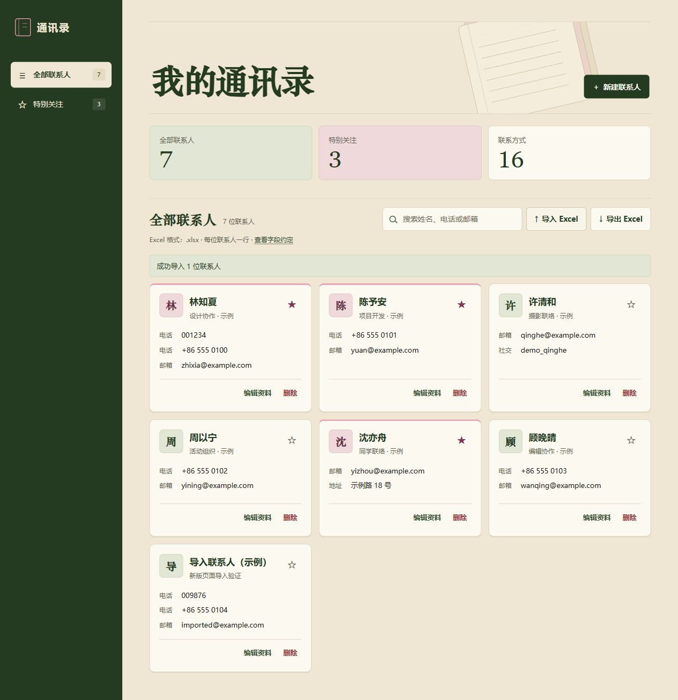
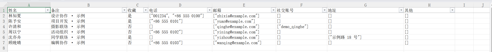
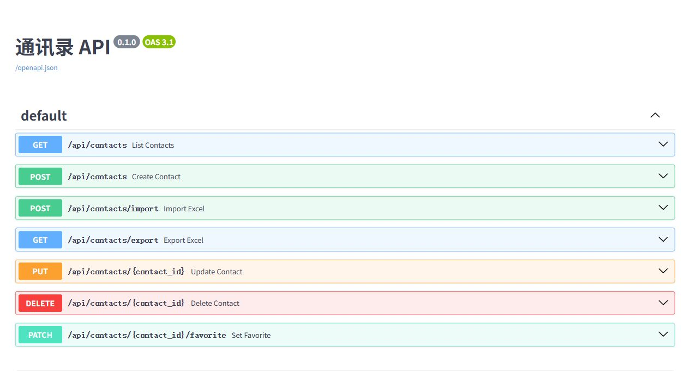
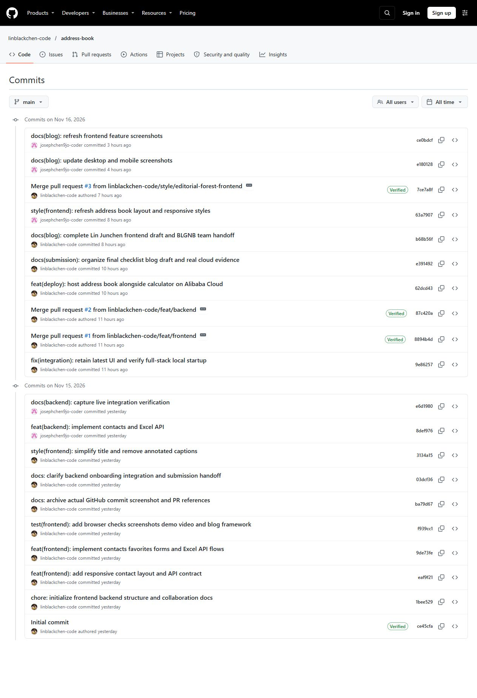
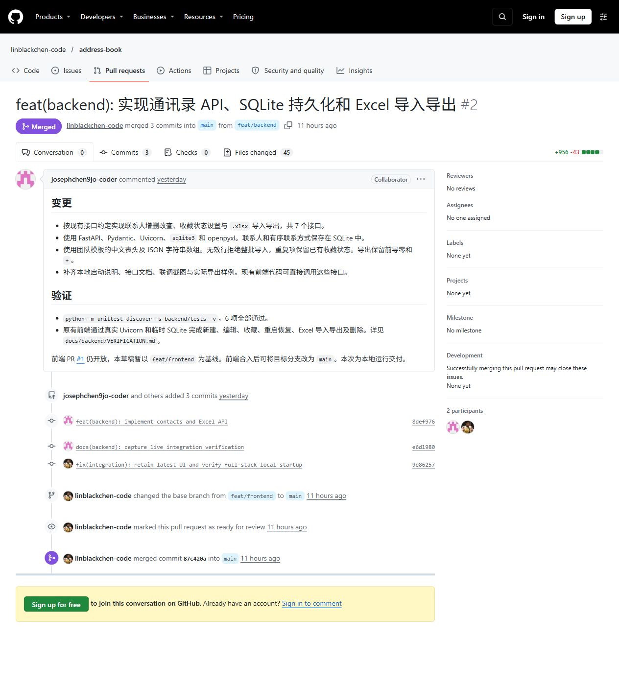

# 演示、截图与样例

## 运行演示

演示在阿里云页面录制，共 2 分 30 秒，依次展示联系人管理、多项联系方式、收藏筛选和 Excel 导入导出。

https://github.com/user-attachments/assets/916eb75a-4956-4b7d-a4cb-8b9b8fc34519

[下载原始 MP4](address-book-demo.mp4)

示例工作簿包含虚构联系人，可直接用于批量导入。[下载 Excel 示例工作簿](contacts-sample.xlsx)

## 界面截图

以下截图使用本地真实后端和虚构联系人。手机布局图来自浏览器的 390 像素宽度预览。

### 桌面与手机布局

### 收藏与多项联系方式

### Excel 导入与导出

### 后端接口

Git 提交与合并截图

主分支提交记录截图对应 `main` 快照 `ce0bdcf`。

## 验证记录

| 记录 | 验证范围 |
| --- | --- |
| [前端检查](../FRONTEND_VERIFICATION.md) | 界面交互和 HTTP 测试桩 |
| [后端回归](../backend/VERIFICATION.md) | 真实 API、SQLite 和 Excel |
| [本地联调](../integration/VERIFICATION.md) | 浏览器操作和服务重启后的持久化 |
| [公网验收](../cloud/VERIFICATION.md) | 阿里云接口、部署隔离和持久化 |

自动检查使用 `docs/fixtures/contacts-template.xlsx` 作为测试工作簿，生成的文件存放在 `.runtime/`。
