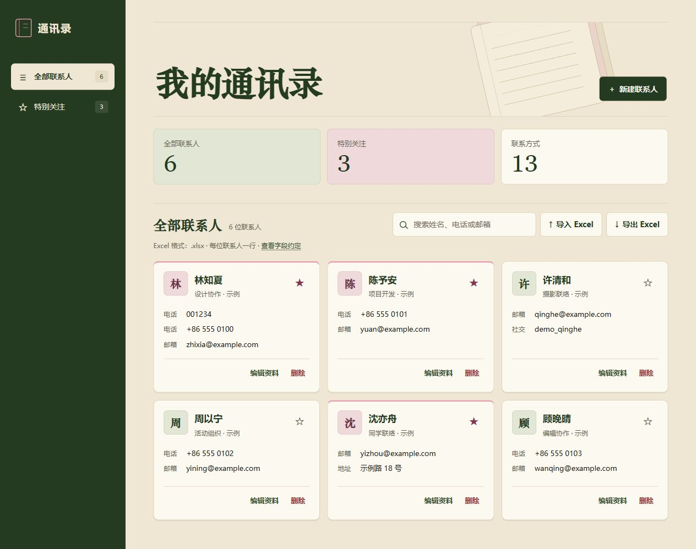
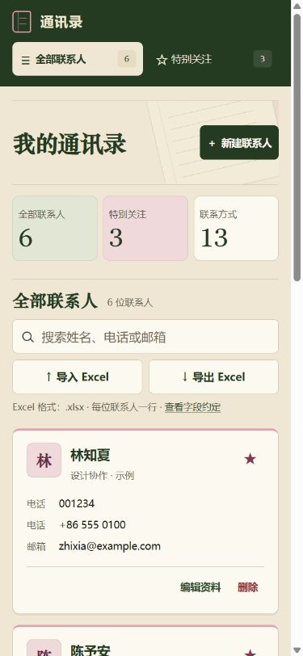

# 通讯录前端

使用 HTML、CSS、JavaScript ES Modules 和 `fetch`。浏览器负责联系人表单、搜索、收藏筛选和导入导出的交互。SQLite 存储和 Excel 文件处理由后端提供。

## 界面预览

### 电脑端



### 手机端



## 启动

使用 Python 3.11 或更新版本，从仓库根目录启动静态服务器。

```sh
python -m http.server 8080 --bind 127.0.0.1
```

在 macOS 或 Linux 可使用 `python3`。Windows 也可运行 `start-frontend.cmd`，或双击仓库根目录的 `start-local.cmd` 同时启动前后端。

| 模式 | 地址 | 数据来源 |
| --- | --- | --- |
| 本地联调 | `http://127.0.0.1:8080/frontend/` | 连接 8000 端口的 API，数据保存到 SQLite |
| 界面预览 | `http://127.0.0.1:8080/frontend/?demo=1` | 使用浏览器内存中的虚构数据，刷新后恢复初始样例 |

完整 Excel 功能需要真实后端。API 不可用时，页面会显示错误。原生前端可直接由静态服务器提供，无需构建。

## API 配置

本地页面默认调用同一主机的 `:8000/api`。部署时，`config.js` 按页面路径解析同源 API，例如 `/address-book/api`。前后端分开部署时，在 `config.js` 设置 `API_BASE`，在后端将页面来源加入 `ADDRESS_BOOK_CORS_ORIGINS`。

## 文件

| 文件 | 用途 |
| --- | --- |
| `index.html` 与 `styles.css` | 页面结构与响应式布局 |
| `app.js` | 联系人列表、表单、收藏与搜索交互 |
| `api.js` | API 请求、错误处理、工作簿上传与下载 |
| `config.js` 与 `demo-api.js` | API 地址、演示开关与样例数据 |

## 浏览器检查

保持静态服务器运行，在另一个终端从仓库根目录执行以下命令。检查脚本需要 Node.js 和 Playwright。

```sh
npm install --no-save --package-lock=false playwright
npx playwright install chromium ffmpeg
node tools/frontend-check.cjs
```

使用现有安装时，可通过 `PLAYWRIGHT_MODULE` 指定 Playwright 模块路径，用 `BROWSER_PATH` 指定 Edge 或 Chrome 路径。脚本覆盖演示模式和 HTTP 测试桩，结果、截图和录像保存在 `.runtime/frontend-check/`。使用真实后端联调时，可连续导入同一份样例，检查第二次没有新增记录，再导出工作簿核对联系人信息。
